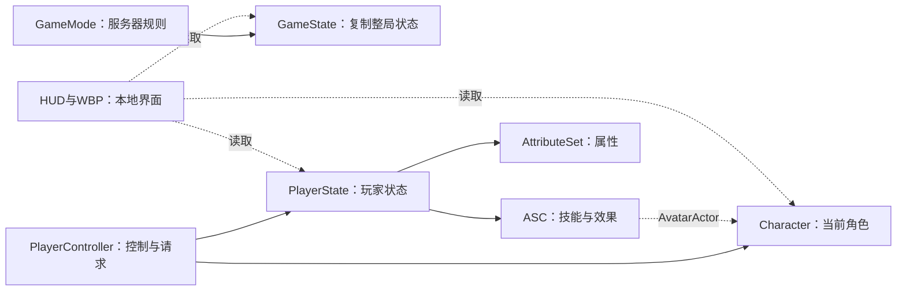

# 代码阅读与学习路线

更新：2026-11-05。源码根目录为 `F:/AI_WorkSpeace/baka/Source/ai`，项目为 `Baka.uproject`。
本文对应当前保存的项目，不把 C++ 默认值当成运行中的资产值。重构记录见 [Readable-Refactor.md](Readable-Refactor.md)。

## 先明确三类代码

| 位置 | 责任 | 读代码时关注 |
| --- | --- | --- |
| `Source/ai` 的 Player、Framework、Combat 等 | 正式玩法与表现 | 谁创建对象、谁修改状态、谁有权威、数据从哪里读 |
| `Source/ai/Private/Debug` | 回归、自检、实机探针、性能采集 | 如何构造问题、断言什么、观测不能证明什么 |
| `Source/aiEditor`、`Tools` | 编辑器资产制作与验证 | 何时保存资产、是否会重建控件树、备份在哪里 |

`WITH_DEV_AUTOMATION_TESTS` 保护测试和探针；正式构建仍保留少量关闭/空操作接口，让调用方不必散落构建宏。
同一个类分到多个 `.cpp`，仍然只有一个类和一个实例；分文件不会增加网络对象或组件。

## 1. 从一次开局建立对象关系

读 `Framework/RogueGameMode.cpp` 的开局、资产配置和子系统配置，再读 `RogueGameState`、`RoguePlayerController`、`RoguePlayerState`、`RogueCharacter`。

这张图的“持有、调用、控制、复制”不是同一种关系。访问器返回指针不等于创建/拥有对象。
先查看地图 World Settings 的 GameMode 覆盖，再沿实际类查看 BP 类默认值和数据资产引用；它们可能覆盖项目设置及 C++ 默认值。

交付：用自己的话解释为什么客户端 HUD 不能等 `GetAuthGameMode()` 有效后才刷新。

## 2. 沿三个 Character 入口理解生命周期

从 `Player/RogueCharacter.cpp` 阅读 `BeginPlay`、`PossessedBy`、`OnRep_PlayerState`。

| 入口 | 处理的问题 | 不应据此假设 |
| --- | --- | --- |
| `BeginPlay` | Actor 已进入运行世界，初始化本地组件与武器实例 | Controller、PlayerState 或远端进度一定已经到齐 |
| `PossessedBy` | 服务器完成接管，接入 PlayerState 的 GAS 并处理档案就绪 | 客户端已经同帧收到全部状态 |
| `OnRep_PlayerState` | 客户端收到 PlayerState，刷新 ASC 的 Avatar 并绑定本地观察 | 可以在客户端重做服务端的基础属性初始化 |

构造函数适合建默认组件和设置默认值；玩家控制关系尚未建立，不适合依赖实际玩家 Controller。
断点记录 NetMode、HasAuthority、Controller、PlayerState、OwnerActor、AvatarActor 和调用栈。一次单机顺序不能代表所有联机场景。

交付：分别记录主机和加入者的三个入口；观察到空指针时，先辨别断点位于 `Super` 前还是后。

## 3. 沿创建者追 GAS，而不是从访问器猜所有权

`RoguePlayerState` 的构造函数创建 ASC 和 AttributeSet；`RefreshAbilityActorInfo` 调用 `InitAbilityActorInfo(this, InPawn)`。
因此玩家 GAS 的 OwnerActor 是 PlayerState，AvatarActor 是当前 Pawn。Character 的访问器只是取得这套对象。

然后读 `Player/RogueCharacter.GAS.cpp`：委托绑定、属性镜像、升级 GE；再读 `AbilitySystem/RogueAttributeSet.cpp` 的属性钳制和伤害执行。
区分 BaseValue、CurrentValue、GE 聚合和复制通知；收到复制值不等于每个本地属性委托都必然执行。

永久成长另读 `Progression/Meta/RogueProgressionSubsystem`：它是 LocalPlayerSubsystem，只管理本机该玩家的 SaveGame。
开局把进度快照交给 PlayerState，服务器按各玩家自己的快照筛卡和初始化基础值；它与一局内的临时升级是两层数据。

交付：跟踪一次攻击力升级，写出“卡片类型 → 效果类 → AttributeSet → 角色快照 → 武器最终伤害”的实际链路。

## 4. 武器先读身份，再读数据与行为

1. `Combat/Weapons/RogueWeaponCatalog.h/.cpp`：稳定行名、数量类型、专属卡所属武器和原生类。
2. `Player/RogueCharacter.Weapons.cpp::InitializeWeapons`：按 `DT_WeaponConfig` 创建武器；显式 WeaponClass 优先，不依赖表行顺序。
3. `Combat/Weapons/RogueWeaponBase`：公共公式与开火接口。
4. 对应派生武器：如何索敌、何时发射、如何生成持续实体。
5. `AbilitySystem/Abilities/RogueWeaponAbility` 与 Task：离散开火/冷却循环；持续实体仍可能由角色 Tick 维护。

Catalog 只描述身份和归属，不存冷却、伤害或弹速。战斗数值读 DT，模型/材质/外观缩放由相应 BP 控制。
正常开局规则、编辑器按表初始数量的调试开关、永久解锁是三个不同条件；冰刀解锁后会随开局装备。
数量/专属卡仍须同时满足永久权限、本局持有及当前前置，不能只检查其中一个。

交付：重排武器表后说明为什么身份不变；再沿冰刀解释基础攻击、基础范围和尺寸升级如何进入最终计算。

## 5. 敌人按生命周期、攻击、移动分别跟踪

| 文件/组件 | 读什么 |
| --- | --- |
| `Enemies/RogueEnemy.cpp` | 构造、Tick、复制激活状态、行为调度 |
| `RogueEnemy.LifeCycle.cpp` | 出池初始化、血量同步、延迟死亡校验、结算和回池 |
| `RogueEnemy.Combat.cpp` | 服务端攻击决策与能力入口、各端多播表现 |
| `RogueEnemy.Movement.cpp` | 目标查询、期望方向、原型走位与绕障入口 |
| `Components/RogueEnemyObstacleMovementComponent` | 建筑绕行、路径预算、恢复策略 |
| `Components/RogueEnemySupportComponent` | 寻找受伤友军、保持距离、治疗选择 |
| `Components/RogueEnemyPresentationComponent` | 外观、攻击/受击表现入口 |

对象池复用不会重跑构造函数。先看 Activate/Deactivate 清掉哪些定时器、引用、能力状态和表现代次，再看新档案如何写入。
死亡标签回调安排下一次定时器调度处理；执行时重新核对 SpawnCycleId、生命和死亡标签，避免旧回调误杀新出池的敌人。
伤害飘字与受击表现会节流，但节流不代表伤害结算次数减少。

交付：说明“旧敌人的延迟死亡回调”为什么不能只靠 Actor 指针判定；画出治疗怪从目标选择到实际回血的调用链。

## 6. 数值函数与刷怪状态机分开学

`Framework/RogueGameModeRules.cpp` 负责从波数/配置计算档案、名额和节奏；加权抽取只维护一套主体。
`Enemies/Spawning/RogueSpawnSubsystem` 持有本波生成预算和类型名额，尝试地面落点并获取池内敌人。
`Framework/RogueGameMode` 协调整局清场、Boss、切图和胜利。

当前昼夜都清场切波；黑夜近战比例、数量和生成倍率从 DA_GameBalance 读。每波累计总量与各类型限制仍存在，全场存活数量限制已移除。
曲线有效时采用曲线结果，缺失时才回退公式。不要把“基础刷怪间隔”“最短间隔”“一次批次”“本波总数”当成同一个参数。

交付：给定一波，手算总量、批次数量和下一次生成延迟，再与 `Rogue.Gameplay.GameBalance.RuleSnapshots` 的结果核对。

## 7. 界面是状态的投影

`UI/RogueHUD.cpp` 负责调度；`.Menus.cpp` 处理战斗菜单，`.Settings.cpp` 处理本地设置，`.CombatFeedback.cpp` 处理血条、受击反馈与飘字。
`.MainMenu.cpp`、`.KillFeedback.cpp` 分别处理主菜单和击杀反馈。实际控件类型和可选绑定看 `UI/Widgets` 的对应基类。

玩家点击 → 请求入口 → 服务器检查并修改状态 → 复制给玩家 → HUD/WBP 更新。
GameState 与 Pawn 的状态可能先后到达，终态判断不能依赖一次固定顺序。Canvas 飘字仍有效，不能因为项目用了 WBP 就删除它。
自定义外观优先编辑已保存的 WBP。当前验证入口见 [Tools/UI/README.md](F:/AI_WorkSpeace/baka/Tools/UI/README.md)。

交付：跟踪一次商店购买，指出哪一步会拒绝余额不足、哪一步只是刷新文字。

## 8. 从回归中学习“怎样证明”

测试位置 `Private/Debug/Tests`，场景基础环境在 `RogueTestWorld.h`。
它只创建可控世界、地板、空进度控制器；各测试自行配置技能、敌人和断言，避免夹具自动满足被测前置。
独立进程探针共用 `RogueProbeSupport.h` 的世界选择和退出日志；各探针保留自己的联机断言。

推荐顺序：GameBalance → UpgradePrerequisite/Meta → FrostBlade → WaveClear → EnemyObstacles → HUD/网络。
修 bug 时先描述触发条件与可观测结果，再找一个能失败的最小场景，修后重跑相关组。纯注释/排版无需每次跑全部测试。
本次整体重构才执行全套行为回归、数值快照比较、蓝图重载与 Shipping 编译。

每次学习记录四项：源码位置、调用者、权威/生命周期、验证证据。面试时用一条实际链路说明设计取舍，比罗列类名更有说服力。
