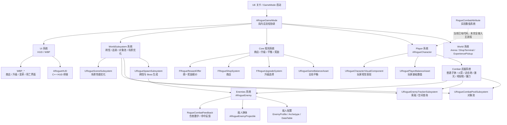
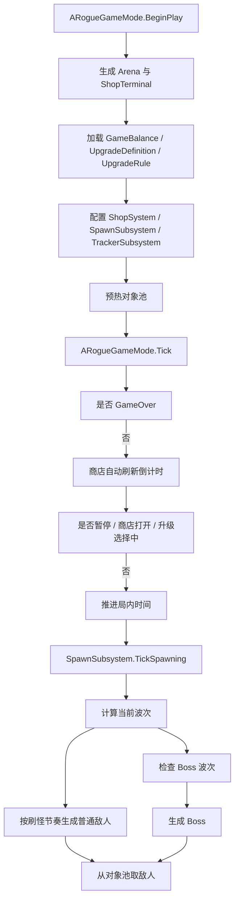
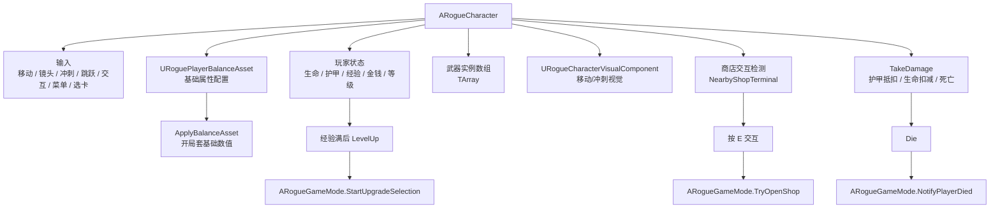
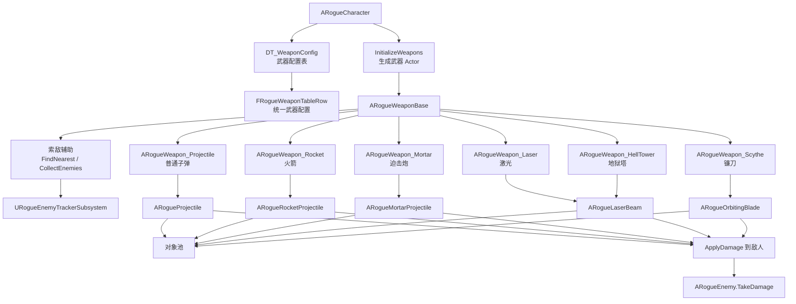
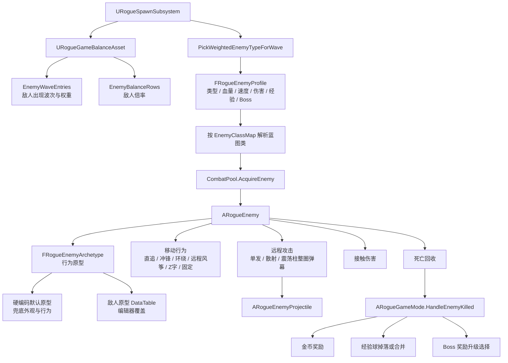
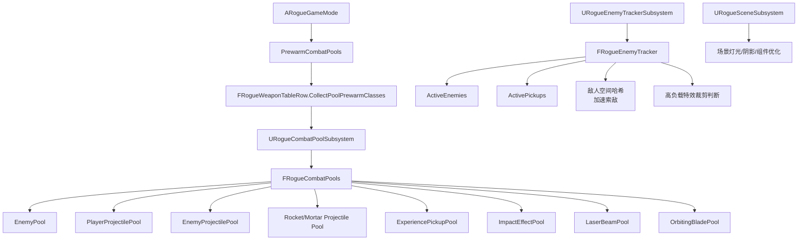
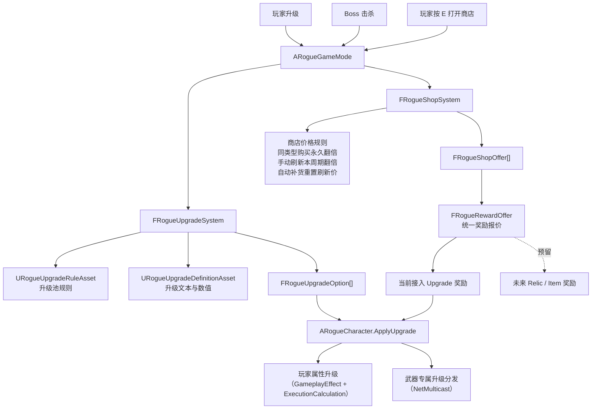
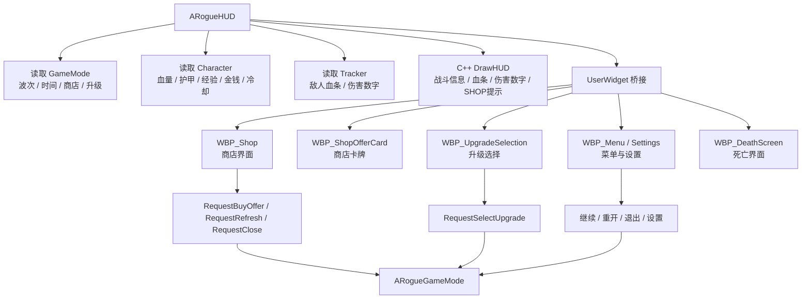
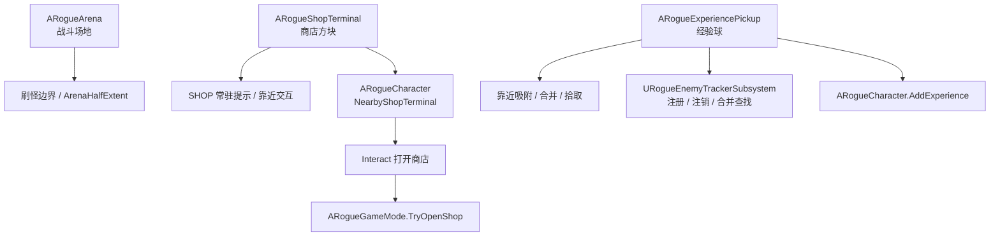
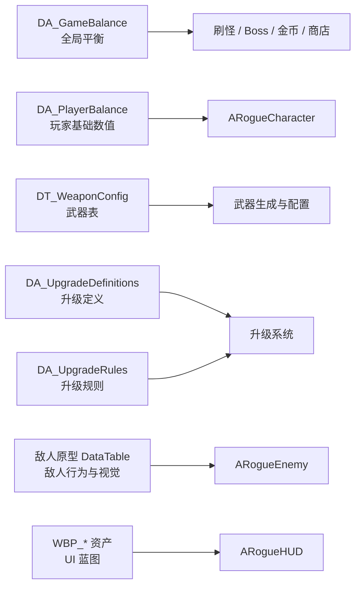

# 当前全系统架构图

这份文档画的是项目当前已经存在的全部主要系统。重点不是“每个类都列出来”，而是把系统边界、数据流、谁调用谁、后续扩展入口画清楚。

> **状态说明（2026-10）**：本文是 GAS 改造前的系统边界快照，图中的 `Core` 目录与 `RogueCombatAttribute` 自研数值系统已不存在。当前类位置见 [Class-Organization.md](Class-Organization.md)，运行时关系与数据流见 [Project-Structure.md](Project-Structure.md)。

## 1. 总览图

## 2. 主循环与运行时流程

## 3. 玩家系统

## 4. 武器与战斗系统

## 5. 敌人与刷怪系统

## 6. 对象池与性能系统

## 7. 升级、商店与奖励系统

## 8. UI 系统

## 9. 世界交互系统

## 10. 数据资产与配置入口

## 11. 当前已有但需要注意的边界

- `ARogueGameMode` 现在主要负责总流程协调，但它仍然是运行时入口，所有“开局初始化、暂停状态、Boss奖励、商店打开关闭”都从这里过。
- `FRogueRewardOffer` 已经作为统一奖励报价结构接入商店，但目前真正落地的奖励类型仍是升级卡，未来道具/遗物可以接在这里。
- 历史上的 `RogueCombatAttribute` 自研数值系统已被 GAS 属性集取代（过程见 [Attribute-System-Migration.md](Attribute-System-Migration.md)）；本文保留它作为当时的边界说明，不代表当前实现。
- 武器配置的唯一真相源是 **`DT_WeaponConfig`（行结构 `FRogueWeaponTableRow`）**：`ARogueCharacter::InitializeWeapons()` 遍历该表逐行 `InitializeWeapon()`，行里的 `WeaponClass` 为空时按**行顺序**回退到 `ARogueCharacter::WeaponClasses[Index]`。
  - 旧的 `Source/ai/Public/Player/RogueWeaponConfig.h`（`FRogueProjectileWeaponConfig` 等 5 个结构体）**已删除**——删除前做过全量取证：全源码 0 引用、752 个资产 0 引用、257MB 的 `ai-Windows.ucas` 0 引用、无字符串式反射引用；临时改名后完整重建 exit 0。若将来需要那套"按武器族分结构"的设计，请从 git 历史取回。
- UI 当前是混合结构：战斗信息仍由 C++ HUD 绘制，商店/升级/菜单/死亡界面走 WBP。
