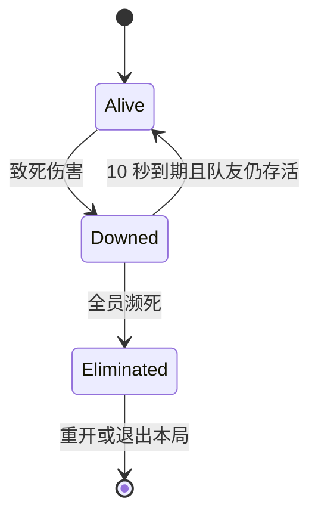

# 玩家濒死、自动复活与团灭

> 2026-10-16：复活等待、恢复生命比例与保护时间现由 `DA_PlayerBalance.Revival` 配置；下文的 10 秒、50% 和 1.5 秒表示默认值。HUD 按复制的服务器截止时刻显示完整剩余秒数，超过 10 秒的配置不会再被截断。

生命归零后，玩家进入无碰撞、不能参与战斗的濒死状态。只要仍有队友存活，服务器在固定 10 秒后复活该玩家；场上所有参与玩家同时濒死时，整局结束并取消复活。

## 状态与职责

| 阶段 | 游戏行为 | 本机界面 |
|---|---|---|
| `Alive` | 正常移动、战斗、碰撞与被索敌 | 正常 HUD 与可操作菜单 |
| `Downed` | 停止移动与攻击，取消角色 Actor 及全部 PrimitiveComponent 碰撞/重叠，退出敌人存活目标集合 | `WBP_ResurrectionScreen`，显示 0–10 秒倒计时 |
| `Eliminated` | 保持幽灵状态，取消复活定时器；本局内不能恢复为 Alive | `WBP_DeathScreen`，可重开或退出 |

`ARogueCharacter::LifeState` 是唯一生命阶段真值。`FRoguePlayerLifeState` 将 `Phase` 与 `ReviveServerTime` 放在同一复制属性中，原子同步给所有客户端。截止时刻使用服务器世界时间，仅在 `Downed` 时有效；复活或团灭时清零。

- `IsAlive()` 统一供索敌、战斗和团灭判断使用。服务器已收到致死伤害而尚未执行濒死善后时，也立即排除该玩家。
- `IsDowned()` 只表示正在等待复活；`IsEliminated()` 表示本局结束；兼容接口 `IsDead()` 返回 `!IsAlive()`。
- `GetReviveSecondsRemaining()` 使用复制截止时刻减同步服务器时间，只用于显示。PlayerState 的同名查询转发给当前角色。
- GAS 继续管理生命属性、伤害、能力、死亡/濒死标签和 Cue。`URogueDownedEffect` 为 Infinite，进入/退出濒死时由生命周期授予/移除，不负责复活期限。复活无敌仍使用带时长 GE，默认 1.5 秒。

## 服务端流程

1. 服务端处理致死伤害，进入 `Downed` 并写入「当前服务器时间 + 10 秒」。保存正常碰撞配置后关闭全部碰撞与重叠，清理移动和武器行为，排定唯一一次性世界定时器。
2. `GameMode::NotifyPlayerDied()` 关闭该玩家的商店与升级状态，调用 `EvaluateTeamWipe()`。团灭集合按实际参与的 PlayerController/PlayerState 计算，排除旁观者；登录或重新持有期间暂缺 Pawn 的玩家不会被当成已经濒死。
3. 尚有存活队友时，定时器到期进入 `TryReviveIfExpired()`。它先检查本局结束和团灭，再确认截止时刻；符合条件才执行 `Revive()`。不依赖 Pawn Tick、GameMode 复活队列或 GE 的剩余时长。
4. 复活在原角色上执行：移回记录的出生位置，恢复最大生命的 50%（至少 1 点）、保存的碰撞/重叠配置和移动输入，清除死亡/濒死效果并应用复活保护，复制 `Alive` 与清零后的截止时刻。
5. 团灭时 GameMode 设置 `GameOver`，对所有参与者执行 `FinalizeForGameOver()`：进入 `Eliminated`、清零截止时刻并清理复活与待处理死亡定时器。到期回调和重复死亡通知都不能把终态玩家复活。同帧致死与复活到期竞争时，先确认团灭。

## 客户端与界面

`OnRep_LifeState()` 只应用幽灵或正常表现，不改血、不创建复活定时器，也不依据迟到的 GAS 标签改变生命阶段。倒计时到零时仍显示等待界面，直到服务器确认 `Alive`；收到复活确认后立即收起。

HUD 每帧独立更新 UMG 状态，画布绘制不作为界面刷新的前提。HUD 通过自己的 owning PlayerController 获取本机角色；每个 HUD 独立缓存状态并核对实际可见性，支持同进程 PIE / 分屏。两个 WBP 具有原生默认类引用，兼容蓝图未配置 WidgetClass 的情况。

团灭显示判据为 `GameState.GameOver || 本机角色.IsEliminated()`，因此角色终态与 GameState 可按任意顺序到达。没有 Pawn 时仍能通过 GameState 显示结算并操作按钮。濒死和结算界面互斥，商店、升级、暂停与设置统一收起；团灭使用 `UIOnly` 输入模式与可见光标。蓝图更新事件返回后，C++ 再应用最终可见性；隐藏时停止动画，防止复活后等待界面残留。

## 验证用例与预期

2026-10-13：以下七项自动化用例全部通过。用例使用实际 GAS 伤害、世界定时器和真实 WBP；复制顺序测试注入接收状态，另已通过真实主机与客户端双进程验证。测试采用无渲染运行，核对 UMG 可见性与输入模式，未做画面截图验收。

| 用例 | 预期 |
|---|---|
| `Rogue.Gameplay.LifeCycle.TenSecondGhostAndRestore` | 一人濒死、另一人存活；9.9 秒前不复活，10 秒后恢复。Actor/所有 PrimitiveComponent 无碰撞与重叠，索敌排除濒死玩家；复活恢复原配置、生命和保护效果 |
| `Rogue.Gameplay.LifeCycle.RepeatedDeathAndMissingEffect` | 重复死亡通知不延长截止时刻或增加驱动；移除濒死 GE 不提前复活、不造成永久濒死；再次死亡仍遵循完整 10 秒 |
| `Rogue.Gameplay.LifeCycle.TeamWipeCancelsRevival` | 第二人濒死后立即结束；所有玩家进入 Eliminated，超过原截止时刻也不复活 |
| `Rogue.Gameplay.LifeCycle.TeamWipeAtRevivalDeadline` | 最后一名队友在复活到期前受致命伤时，团灭优先，不允许到期玩家抢先复活 |
| `Rogue.Gameplay.LifeCycle.SameFrameLethalDamage` | 同帧致死时正确团灭，尚未执行善后的零血角色不能保住整局 |
| `Rogue.UI.LifeCycle.ReplicationOrderAndNoPawn` | 真实两个 WBP 在倒计时为零、GAS 标签迟到、GameOver/Eliminated 两种到达顺序、缺失 Pawn 和可见性漂移时仍显示正确界面 |
| `Rogue.UI.ReviveCountdown.MultipleHUDsAndVisibilityDrift` | 同进程两个 HUD 的刷新顺序不会互相影响；复活后隐藏并纠正残留可见性 |

实际双进程验收已确认客户端濒死、自动复活、同帧团灭与全队 ServerTravel 重开；错开死亡及到期竞争由自动化用例覆盖。每个窗口应只显示自己的等待界面；怪物持续追击存活队友；自动复活后等待界面消失。团灭后所有窗口只显示结算，等待超过 10 秒仍不复活，重开进入新局。

## 主要落点

- `Source/ai/Public/Player/RoguePlayerLifeState.h`：生命阶段、复制载荷与固定 10 秒常量。
- `Source/ai/Private/Player/RogueCharacter.LifeCycle.cpp`：濒死、单定时器、复活、碰撞保存/恢复与客户端应用。
- `Source/ai/Private/Framework/RogueGameMode.Players.cpp`：参与者集合、团灭终态与重开请求。
- `Source/ai/Private/UI/RogueHUD.cpp` 及复活/结算 Widget 基类：本地界面与输入互斥。
- `Source/ai/Private/Debug/Tests/RoguePlayerLifeCycleTests.cpp`：生命周期与复制顺序回归用例。

历史迁移过程见 [GAS-Main-Architecture-Plan.md](GAS-Main-Architecture-Plan.md)；其中 Phase 4 的 GE 到期复活与三个驱动方案已被本流程取代。

## 本次真实联机记录

- 服务端实际复活等待：10.018 秒（目标十秒，受帧调度影响）。
- 团灭后继续观察：12.505 秒，所有玩家仍为 Eliminated，复活倒计时为零。
- 客户端收到 Downed / Alive / Eliminated，碰撞按关 / 开 / 关切换；等待界面显示、复活后隐藏、团灭后显示结算。
- 服务器使用当前地图完整路径 ServerTravel，全队进入新局；两名玩家及各自 PC / Pawn / PlayerState / ASC 配对正确，Alive 与 GameOver=false，旧界面已清除。
- 重开时卡牌 Widget 的默认类引用存在实例 UPROPERTY 上，避免静态裸引用被垃圾回收后失效。
