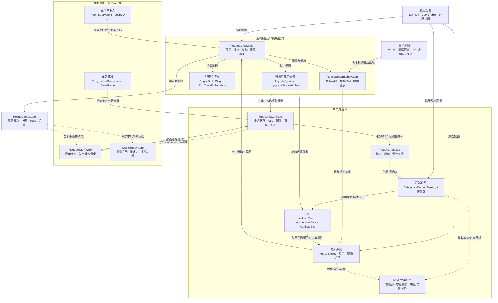
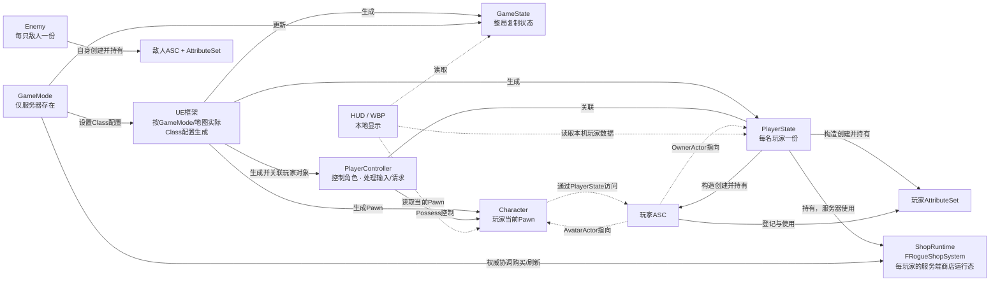
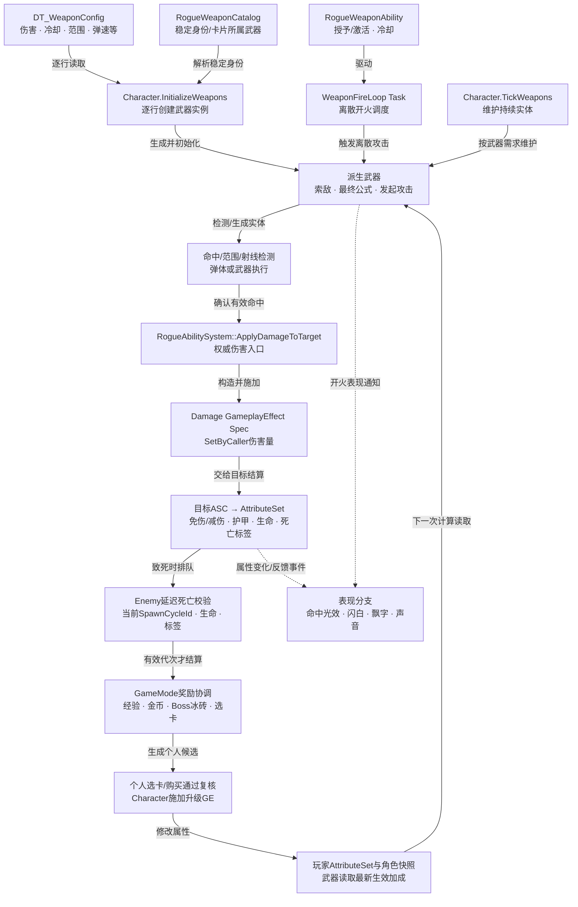
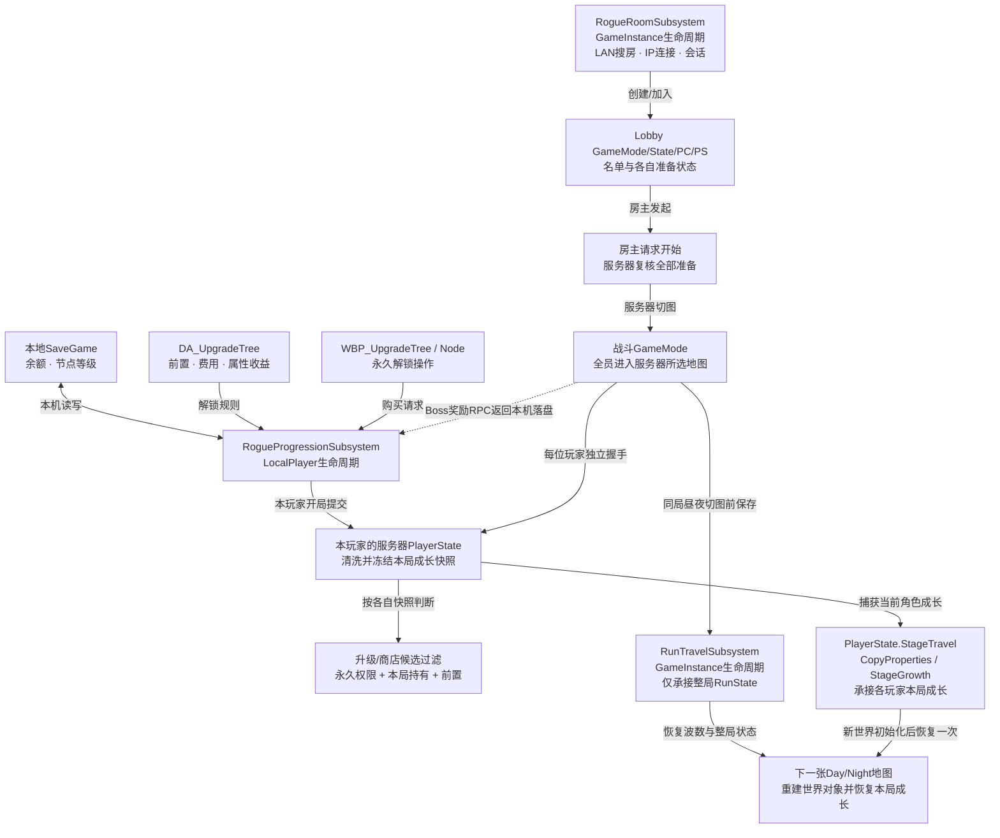

# Baka 当前项目结构图

核对日期：2026-11-05。工程：`F:/AI_WorkSpeace/baka/Baka.uproject`，UE 5.5。

项目以 UE Gameplay Framework 组织对象与整局流程，GAS 承担能力、属性和效果；刷怪、地图、永久成长、商店、联机大厅、界面与音频有各自实现。

图中箭头表示标注的调用、数据流或持有关系，**不表示继承**。`ARogue…` 是 Actor 类，`URogue…Subsystem` 由 UE 管理生命周期；`FRogueUpgradeSystem`、`FRogueShopSystem` 是结构体，`RogueWeaponCatalog` 是描述与查询用的命名空间。

## 1. 各系统总览



这是一张系统总览：战斗区域不代表其中对象都只存在于服务器。武器逻辑 Actor 在各端角色初始化时创建，实际伤害有权威判断；图形、音效和本地 UI 按各自表现路径执行。

## 2. 核心对象：谁创建、谁持有、谁使用



- 访问器返回对象不意味着创建或拥有对象；Character 使用 PlayerState 的 GAS。
- GameMode 的 Class 配置交给引擎生成对象，不应把这些关系全写成业务代码 `new`。
- `ShopRuntime` 本体不复制；其报价、开关和期限等镜像复制给拥有者。待选卡也是每玩家一份。
- PlayerState、Character、GameState 的不同状态可能先后到达客户端，不能假定同帧更新。

## 3. 一次攻击、受击与升级的数据流



图中“命中”不是统一的一颗普通子弹：激光可在武器内结算，冰刀由扇形/波实体处理，不同武器共享伤害入口。表现也可能由开火事件直接触发，不必等目标扣血。

## 4. 永久成长、联机与跨地图承接



本地永久存档、整局切图快照、各玩家局内成长是三层数据。RunTravelSubsystem 只保存整局 RunState；各玩家已结算属性与生命流程由 PlayerState.StageTravel 和 Character 的捕获/恢复路径承接，不把旧世界里的 GE 对象直接搬到新世界。

## 5. 生命周期与模块边界

| 生命周期/范围 | 主要对象 | 关系 |
| --- | --- | --- |
| 每个本地玩家 | `RogueProgressionSubsystem` | 本机该玩家的永久成长和 SaveGame |
| 每个 GameInstance | `RogueRoomSubsystem`、`RogueMusicSubsystem`、`RogueRunTravelSubsystem` | 会话、本地音乐、整局RunState换图承接 |
| 每个 World | `RogueSpawnSubsystem`、`RogueCombatPoolSubsystem`、`RogueEnemyTrackerSubsystem`、`RogueCombatAudioSubsystem` | 刷怪、复用、空间查询、本地战斗声音；随世界重建 |
| 每名玩家 | `RoguePlayerState`、`RoguePlayerController`、`RogueCharacter` | 状态与GAS、控制、当前角色；三者生命周期不同 |
| 每个本地视图 | `RogueHUD` 和 WBP 实例 | 读取状态并显示，转交操作请求 |
| 每只敌人/每个池实体 | `RogueEnemy`、弹体/效果 | Actor可复用；每次出池应清理旧生命周期状态 |
| Runtime模块 | `Source/ai` | 实际游戏；大多数功能目录仍在同一个模块里 |
| 开发宏 | `ai/Private/Debug` | 测试/探针；Shipping保留必要空接口 |
| Editor模块 | `Source/aiEditor` | 资产生成、验证、预览；不属于正式游戏模块 |
| 编辑器脚本 | `Tools` | 调用Editor工具，保存或检查资产；不在运行时自动执行 |

`GameInstance` 本身没有跨网络自动同步的含义。每台机器的音乐/房间服务各自存在；共享玩法状态通过 Actor 的复制/RPC 传播。

## 6. 当前代码与资产目录

```text
Baka.uproject
├─ Source/
│  ├─ ai/                           Runtime玩法模块
│  │  ├─ Public/                    对外声明
│  │  └─ Private/                   实现，按相同业务目录归类
│  │     ├─ Framework/              GameMode / GameState / 规则 / 昼夜切图
│  │     ├─ Player/                 Character / PlayerState / Controller / 外观组件
│  │     ├─ AbilitySystem/          ASC / AttributeSet / Ability / Task / GE / Cue
│  │     ├─ Combat/
│  │     │  ├─ Weapons/             Catalog / 武器基类 / 八种派生武器
│  │     │  ├─ Projectiles/         飞行、碰撞与命中实体
│  │     │  ├─ Visuals/             光束、锁定圈、命中/击杀反馈
│  │     │  ├─ Pooling/             对象池
│  │     │  └─ Targeting/           敌人登记与空间查询
│  │     ├─ Enemies/
│  │     │  ├─ Data/               原型与数据表转换
│  │     │  ├─ Spawning/           生成预算、落点与导航预算
│  │     │  ├─ Components/         绕障、治疗、表现等专用组件
│  │     │  └─ Visuals/            敌人专用表现实体
│  │     ├─ Progression/            Meta / Upgrades / Shop
│  │     ├─ Networking/             房间与大厅
│  │     ├─ UI/                     HUD / Widgets / 展示数据
│  │     ├─ Audio/                  音乐与战斗音效
│  │     ├─ World/                  刷怪区域、空气墙、商店、经验拾取
│  │     ├─ Shared/                 共用枚举与载荷
│  │     └─ Debug/                  自检、探针、Tests
│  └─ aiEditor/                     独立Editor模块
│     └─ Private/                   UI/Authoring / UI/LegacyThemes / AssetSetup / Preview / Support
├─ Content/                         UE中的 /Game
│  ├─ Map/                          MainMenu + Day/Night各五张战斗图
│  ├─ Data/                         DA / DT / 成长曲线
│  ├─ BP/                           Framework / Player / Enemy / Projectiles / World等
│  ├─ UMG/                          WBP / 字体 / 界面素材
│  └─ GameAssets/                   当前美术资产目录之一
├─ Config/                          默认配置；实际地图/BP/资产可覆盖相关默认值
├─ Docs/                            系统说明与阅读指南
└─ Tools/                           编辑器脚本和验证入口
```

GameAssets 不是承诺全部历史素材均已迁入的唯一物理目录；查具体资源以 Content Browser 和资产引用为准。

## 7. 大文件拆分后的阅读位置

| 同一个类 | 实现文件 | 读什么 |
| --- | --- | --- |
| Character | 主文件、`.Input`、`.GAS`、`.Weapons`、`.Progression`、`.LifeCycle` | 生命周期与调度、输入、GAS、武器、成长、濒死复活 |
| GameMode | 主文件、`.Players`、`.Progression`、`.BattleStage`、`.Victory` | 调度、玩家/重开、奖励/购买、昼夜承接、通关 |
| Enemy | 主文件、`.LifeCycle`、`.Combat`、`.Movement`、`.Flying`、`.Skyfall`、`.HitFeedback`、`.AttackAudio` | 调度、池生命周期、攻击、移动、飞行、落地攻击、受击、音效 |
| HUD | 主文件、`.MainMenu`、`.Menus`、`.Settings`、`.CombatFeedback`、`.KillFeedback` | 调度、主菜单、局内菜单、设置、血条/飘字、击杀反馈 |

分文件不会新建一个同名系统对象；`RogueWeaponCatalog` 与规则函数也不应被理解成额外“全局管理器”。

核对入口：[GameMode](F:/AI_WorkSpeace/baka/Source/ai/Public/Framework/RogueGameMode.h)、[PlayerState](F:/AI_WorkSpeace/baka/Source/ai/Public/Player/RoguePlayerState.h)、[Character](F:/AI_WorkSpeace/baka/Source/ai/Public/Player/RogueCharacter.h)、[Enemy](F:/AI_WorkSpeace/baka/Source/ai/Public/Enemies/RogueEnemy.h)、[HUD](F:/AI_WorkSpeace/baka/Source/ai/Public/UI/RogueHUD.h)、[武器Catalog](F:/AI_WorkSpeace/baka/Source/ai/Public/Combat/Weapons/RogueWeaponCatalog.h)。

配套：[代码阅读指南](F:/AI_WorkSpeace/baka/Docs/Code-Reading-Guide.md)、[源码目录说明](F:/AI_WorkSpeace/baka/Docs/Class-Organization.md)。
