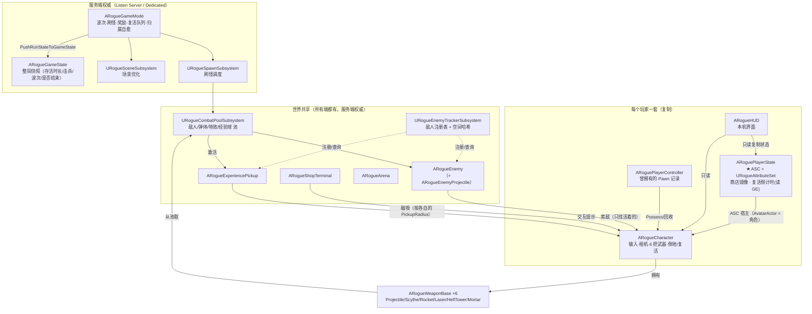
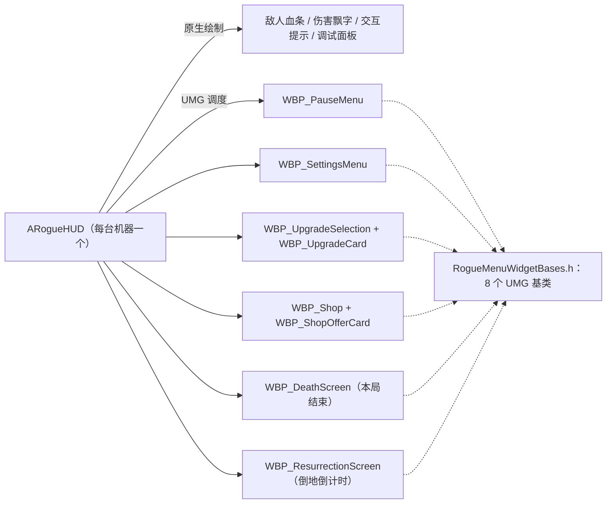
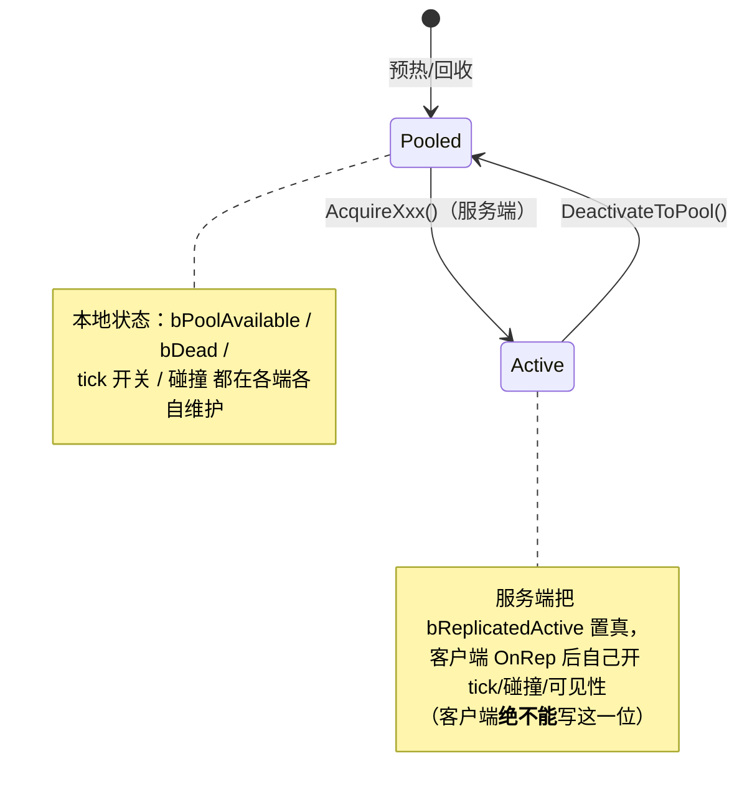
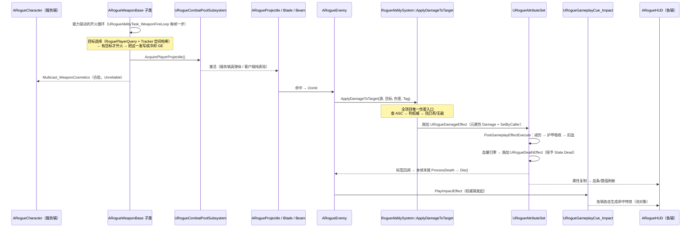
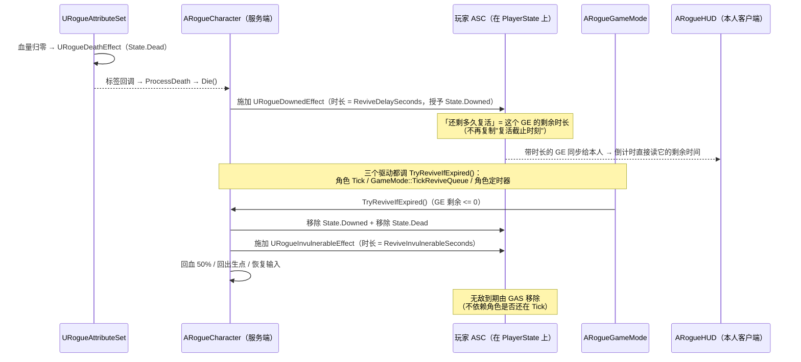
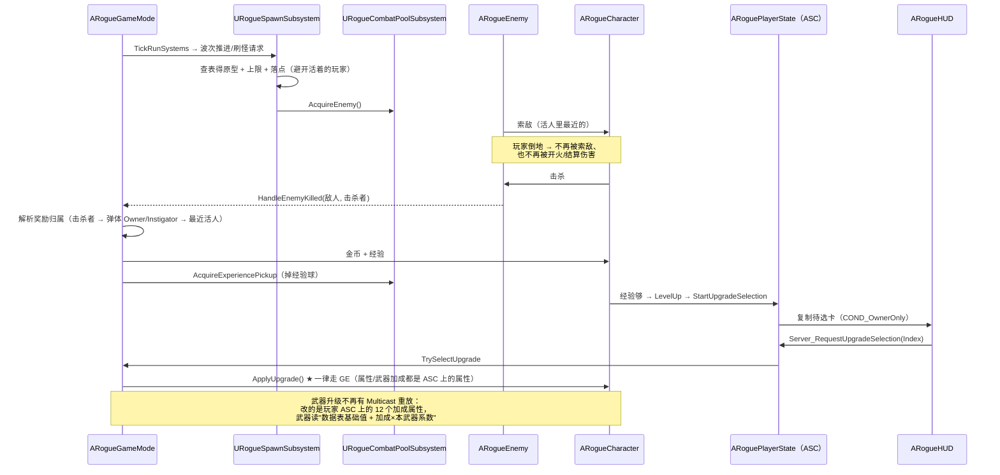

# ai 项目结构图（当前状态）

> 快照时间：**GAS 主架构改造完成之后**（Phase 1b–4：武器开火 / 武器升级 / 敌人攻击 / 倒地复活全部 GAS 化）。
> 本文只描述**现在**的结构；改造过程、"为什么这么改"与逐阶段的验证证据见
> [GAS-Main-Architecture-Plan.md](GAS-Main-Architecture-Plan.md)。
> 更早的迁移记录见 [Attribute-System-Migration.md](Attribute-System-Migration.md)
> 与 [System-Architecture-Overview.md](System-Architecture-Overview.md)。

---

## 0. 一页总览

| 层 | 目录 | 文件 | 行数 | 一句话职责 |
|---|---|---:|---:|---|
| 规则与全局 | `Core/` | 33 | 5165 | GameMode / GameState / 升级与商店规则 / 标签 / 通用查询 |
| 战斗 | `Combat/` | 26 | 4500 | 6 把武器 + 弹体 / 光束 / 刀片 / 特效（全部走对象池） |
| 敌人 | `Enemies/` | 10 | 4526 | 敌人本体、原型表、数据表、视觉资源、敌方弹体 |
| 玩家 | `Player/` | 10 | 3797 | 角色、PlayerState（**ASC 在这里**）、视觉组件、平衡资产 |
| 能力系统 | `AbilitySystem/` | 29 | 2967 | GAS 层：属性集、GE、**四类能力**、能力任务、cue |
| 子系统 | `Subsystems/` | 8 | 891 | 对象池、敌人追踪、刷怪调度、场景优化 |
| UI | `UI/` | 4 | 2619 | HUD（原生绘制）+ 8 个 UMG 基类 |
| 世界 | `World/` | 6 | 971 | 竞技场、商店终端、经验球 |
| **合计** | `Source/ai/` | **126** | **~25.4k** | |

关键事实（回答"为什么结构是这样"）：

- **权威全在服务端**：AI、伤害、经验、刷怪、商店、复活时机都只在服务端算。
- **客户端只做三件事**：把复制的状态画出来（HUD/血条/飘字）、本地预测自己的操作（移动/开火/冲刺）、按复制的镜子推 UI。
- **数值只有一个真相源**：`URogueAttributeSet`（GAS）。角色上的 `MaxHealth/MoveSpeed/...` 是不可编辑的**只读缓存**。
- **玩法动作全部是 GameplayAbility**（这是本次改造的结论，也是本文最重要的一条）：

| 玩法动作 | 能力 | 持续/一次性 | 联机策略 | 谁决定"什么时候" |
|---|---|---|---|---|
| 冲刺 | `URogueGameplayAbility_Dash` | 一次性 | LocalPredicted | 玩家输入（`TryActivateAbilitiesByTag`） |
| 6 把武器自动开火 | `URogueWeaponAbility`（6 子类） | **持续**（逐帧心跳任务） | LocalPredicted | 能力自己（冷却 GE 是唯一节奏来源） |
| 敌人接触 / 远程攻击 | `URogueEnemyAttackAbility` 两子类 | 一次性 | ServerOnly | AI 决策（距离 + 节流），AI 只调 `TryActivateAbility` |
| 敌人地面波 | `URogueEnemyAttackAbility_GroundWave` | **持续到波结束** | ServerOnly | 同上（起波后由能力推进扩散） |

- **对象池是硬约束**：200+ 敌人 + 上千弹体，所有战斗 actor 都必须能复用（池化契约见 §5）。

---

## 1. 源码目录树

```text
Source/ai/
├── ai.Build.cs                    模块依赖（GAS 插件等）
├── Public/                        头文件（与 Private 同构）
└── Private/
    ├── AbilitySystem/             ★ GAS 层（29 文件 / 2967 行）
    │   ├── RogueAbilitySystemComponent.*    ASC：Mixed 模式（玩家）/ Minimal（敌人）
    │   ├── RogueAttributeSet.*              唯一数值真相源 + 减伤链 + 死亡判定
    │   ├── RogueDamageEffect.*              伤害 GE（元属性 Damage + SetByCaller）
    │   ├── RogueAttributeUpgradeEffect.*    全部属性/武器升级共用的一份 GE
    │   ├── RogueUpgradeExecution.*          升级 GE 的 ExecutionCalculation（枚举→属性）
    │   ├── RogueStateEffects.*              ★ 全部"授予状态标签"的 GE（6 个）
    │   │                                    基类 URogueStateTagEffect
    │   │                                    + 死亡 / 刚受伤 / 冲刺冷却 / 武器冷却 / 敌人攻击冷却
    │   │                                    + 倒地等待(State.Downed) / 复活无敌(State.Invulnerable)
    │   │                                    + GetDownedSecondsRemaining()（两端共用的倒计时读数）
    │   ├── RogueGameplayCue_Impact.*        C++ cue 通知 + 原生 cue 注册入口
    │   ├── RogueAbilitySystemLibrary.*      ApplyDamageToTarget（全项目唯一伤害入口）
    │   └── Abilities/
    │       ├── RogueGameplayAbility_Dash.*      冲刺技能（LocalPredicted）
    │       ├── RogueAbilityTask_Dash.*          冲刺的位移任务（逐帧）
    │       ├── RogueWeaponAbility.*             ★ 武器自动开火（持续激活，6 个子类各驱动一把武器）
    │       ├── RogueAbilityTask_WeaponFireLoop.* 武器开火的逐帧心跳（bTickingTask）
    │       ├── RogueEnemyAttackAbility.*        ★ 敌人攻击（接触/远程/地面波，ServerOnly）
    │       └── RogueAbilityTask_AttackTick.*    地面波的逐帧心跳（只有持续型攻击用它）
    ├── Combat/                    ★ 武器与弹体（26 文件 / 4500 行）
    │   ├── RogueWeaponBase.*                武器基类：数据表行 + 能力接口 + 生效数值
    │   │                                    （CollectFireTargets / FireAtTargets / GetFireAbilityClass）
    │   ├── RogueWeapon_Projectile/Scythe/Rocket/Laser/HellTower/Mortar.*
    │   ├── RogueProjectile.*                玩家弹体（池化）
    │   ├── RogueRocketProjectile.*          火箭（范围伤害）
    │   ├── RogueMortarProjectile.*          迫击炮（继承火箭，抛物线）
    │   ├── RogueLaserBeam.*                 激光束（池化）
    │   ├── RogueOrbitingBlade.*             环绕刀片（池化）
    │   └── RogueImpactEffect.*              命中特效（池化，由 cue 驱动）
    ├── Core/                      ★ 规则与全局（33 文件 / 5165 行）
    │   ├── RogueGameMode.*                  ★ 服务端总控（唯一权威；含复活兜底/归属自愈/暂停看门狗）
    │   ├── RogueGameState.*                 复制给所有客户端的整局快照
    │   ├── RoguePlayerQuery.*               ★ "谁算活着"的唯一实现（4 处调用共用）
    │   ├── RogueGameplayTags.*              全部原生 Tag（C++ 声明，与 ini 无关）
    │   ├── RogueSelfTest.*                  ★ 开发自检开关（CVar；默认关）
    │   ├── RogueGameModeRules.*             波次/商店/刷怪的可调规则
    │   ├── RogueUpgradeSystem.*             抽卡：候选池 / 已购次数 / 排队
    │   ├── RogueUpgradeSystemRules.*        升级定义与出现规则（数据表驱动）
    │   ├── RogueShopSystem.*                每玩家一份的商店运行态（服务端）
    │   ├── RogueCombatPools.*               池容器与预热量配置（数据处理）
    │   ├── RogueEnemyTracker.*              敌人/经验球注册表 + 空间哈希（数据处理）
    │   ├── RogueCombatFeedback.*            伤害飘字：发给**本机所有本地玩家**
    │   ├── RogueGameModeConfig.h            可调参数结构体（RunState/Pool/Spawn/Boss/性能）
    │   ├── RogueTypes.h / RogueRewardTypes.h  枚举与统一奖励报价（含 FRogueWeaponBonusValues）
    │   └── RogueGameBalanceAsset.* / RogueUpgradeDefinitionAsset.* / RogueUpgradeRuleAsset.*
    ├── Enemies/                   ★ 敌人（10 文件 / 4526 行）
    │   ├── RogueEnemy.*                     敌人本体：AI（移动/选目标/**攻击决策**）+ 攻击执行
    │   ├── RogueEnemyArchetypes.*           原型结构 + 从硬编码构建（数据表缺省回退）
    │   ├── RogueEnemyDataTable.h            数据表行结构（8 种专属参数）
    │   ├── RogueEnemyDataTable.cpp          行 → 原型 的翻译
    │   ├── RogueEnemyVisualResources.*      8 种敌人的视觉资源表
    │   └── RogueEnemyProjectile.*           敌方弹体（池化）
    ├── Player/                    ★ 玩家（10 文件 / 3797 行）
    │   ├── RogueCharacter.*                 角色：输入、相机、武器能力授予、倒地/复活、属性镜像
    │   ├── RoguePlayerState.*               ★ ASC + 属性集 + 商店镜像 + 复活倒计时读数
    │   ├── RoguePlayerController.*          记录"曾拥有的 Pawn"，供归属自愈回收
    │   ├── RogueCharacterVisualComponent.*  角色视觉（程序化搭建）
    │   └── RoguePlayerBalanceAsset.*        玩家基础属性（灌进属性集的唯一数据源）
    ├── Subsystems/                ★ 世界子系统（8 文件 / 891 行）
    │   ├── RogueCombatPoolSubsystem.*       UWorldSubsystem：所有战斗 actor 的池
    │   ├── RogueEnemyTrackerSubsystem.*     UTickableWorldSubsystem：注册表 + 剔除/降频
    │   ├── RogueSpawnSubsystem.*            UWorldSubsystem：波次刷怪、上限、落点
    │   └── RogueSceneSubsystem.*            UWorldSubsystem：场景性能优化开关
    ├── UI/                        ★ 界面（4 文件 / 2619 行）
    │   ├── RogueHUD.*                       原生绘制：血条/飘字/提示 + 所有界面调度
    │   └── RogueMenuWidgetBases.*           8 个 UMG 基类（见 §3）
    └── World/                     ★ 世界 actor（6 文件 / 971 行）
        ├── RogueArena.*                     竞技场边界与地面
        ├── RogueShopTerminal.*              商店终端（交互提示）
        └── RogueExperiencePickup.*          经验球（池化 + 磁吸）
```

★ = 这一层最常被改动的入口。

---

## 2. 运行时对象关系（谁拥有谁）



**要点**

- `ARogueCharacter` 与 `ARogueEnemy` 都实现了 `IAbilitySystemInterface`：
  玩家的 ASC **不在 Pawn 上**（在 `PlayerState`），Pawn 只做转发；敌人的 ASC 就在自己身上。
  漏掉这个转发接口的后果是"敌人打玩家永远不掉血"（详见头文件注释）。
- 子系统都是**世界级**的（`UWorldSubsystem`），随世界创建/销毁，不需要 GameMode 手动管理生命周期。

---

## 3. UI 组成



- 每个界面都是"**C++ 基类提供数据 + 蓝图实现外观**"：C++ 侧 `Update*View(ViewData)` 推数据，
  蓝图侧实现 `On*Updated` 画出来（例如 `URogueDeathScreenWidgetBase::UpdateDeathView`）。
- 输入模式由 **每台机器自己推导**（暂停菜单 / 商店 / 选卡 / 倒地 → GameAndUI + 光标），不需要 RPC。

---

## 4. 网络权威划分

| 内容 | 所在类 | 复制方式 |
|---|---|---|
| 波次 / 刷怪 / 击杀奖励 / 是否结束 | `ARogueGameMode`（服务端） | → `ARogueGameState` 快照 → 复制给所有人 |
| 属性（生命/护甲/移速/…） | `URogueAttributeSet`（服务端权威） | 每个属性 `COND_None`（常规复制） |
| 经验 / 等级 / 金币 | `ARogueCharacter` | `COND_OwnerOnly` |
| 商店报价 / 是否打开 / 刷新价格 | `ARoguePlayerState`（镜像字段） | `COND_OwnerOnly` |
| 复活倒计时 | ASC 上的 `URogueDownedEffect`（带时长的 GE） | GE 随 ASC 同步给**本人**（Mixed 模式）；**不再有**专门的复制字段 |
| 复活无敌 | ASC 上的 `URogueInvulnerableEffect`（带时长的 GE） | 同上（判定只在服务端，客户端读标签即可） |
| 倒地状态 `bDead` | `ARogueCharacter` | 复制给**所有人**（队友要看得见） |
| 敌人是否活跃 `bReplicatedActive` | `ARogueEnemy` / 经验球 | 复制（池化对象必须显式告诉客户端"我上线了"） |
| 武器开火表现 | `ARogueCharacter::Multicast_WeaponCosmetics` | `NetMulticast, Unreliable`（每帧合批） |
| 武器升级结果 | 玩家 ASC 上的 12 个加成属性 + `ARogueCharacter::WeaponBonusSnapshot` | 属性常规复制 + 快照 `COND_None`（**不再有** Multicast 重放） |
| 敌方弹体表现 | `ARogueEnemy::Multicast_SpawnCosmeticProjectile` | `NetMulticast, Unreliable` |
| 打击特效 | `RogueGameplayCues::EnsureNativeImpactCuesRegistered` + `URogueGameplayCue_Impact` | GAS cue 多播（原生类注册进 cue set） |
| 选卡 / 商店操作 / 重开 | `ARoguePlayerState::Server_Request*` | `Server, Reliable`（带 Validate） |

> ⚠️ 判"我是不是服务端"一律用 `GetNetMode() != NM_Client`，**不要用 `HasAuthority()`**：
> 客户端上"本机拥有"的 Pawn 也是 `ROLE_Authority`。参见 `ARogueCharacter::IsAuthoritySide()`。

---

## 5. 池化契约（所有战斗 actor 都必须遵守）



---

## 6. 数据流 A：一次开火 → 伤害 → 死亡



### 6.1 数据流 A2：玩家倒地 → 复活（Phase 4 之后全是 GE）



---

## 7. 数据流 B：刷怪 → 奖励 → 升级



---

## 8. 资产 ↔ 代码对应

| 资产 | 类型 | 对应代码 |
|---|---|---|
| `DT_FRogueEnemyArchetypeRow` | DataTable | `FRogueEnemyArchetypeRow` → `RogueEnemyDataTable.cpp` → `FRogueEnemyArchetype` |
| `DT_WeaponConfig` | DataTable | `FRogueWeaponTableRow`（`RogueWeaponBase.h`）→ 每把武器的配置 |
| `DT_FRogueUpgradeDefinitionRow` | DataTable | `FRogueUpgradeDefinitionRow` |
| `AS_RoguePlayerBalanceAsset` | DataAsset | `URoguePlayerBalanceAsset`（灌进属性集的基础属性） |
| `AS_RogueGameBalanceAsset` | DataAsset | `URogueGameBalanceAsset`（波次/商店/敌人平衡 ） |
| `AS_UpgradeDefinitionAsset` / `AS_RogueUpgradeRuleAsset` | DataAsset | `URogueUpgradeDefinitionAsset` / `URogueUpgradeRuleAsset` |
| `BP_RogueGameMode` | Blueprint | `ARogueGameMode`（**关卡默认 GameMode**） |
| `BP_RogueCharacter` | Blueprint | `ARogueCharacter`（蓝图里只配资源/数值引用） |
| `BP_RogueHUD` | Blueprint | `ARogueHUD`（挂 6 个 WBP 类） |
| `BP_EnemyBase` + 8 个敌人 BP | Blueprint | `ARogueEnemy`（原型参数全部来自数据表） |
| `BP_Projectile/*` | Blueprint | 玩家弹体/火箭/迫击炮/光束/刀片（只配外观） |
| `WBP_*`（8 个） | UMG | `RogueMenuWidgetBases.h` 的 8 个基类 |

---

## 9. "我要改 X，该动哪里"

| 想做的事 | 落点 |
|---|---|
| 加一张升级卡 | `RogueTypes.h`（枚举）→ `RogueUpgradeSystemRules.cpp`（定义/出现规则）→ `ARogueCharacter::ApplyUpgrade()`（落地） |
| 加一把新武器 | `RogueWeaponBase` 子类（构造里设 `FireAbilityClass` + 实现 `CollectFireTargets`/`FireAtTargets`）→ `RogueWeaponAbility` 加一个子类（一行 `GetDrivenWeaponClass`）→ `DT_WeaponConfig` 加行 → `RogueCombatPools`（预热量） |
| 改武器开火节奏 | 武器侧的 `GetEffectiveCooldown()`（**加成怎么换算成冷却**是武器的知识）；节拍由 `URogueWeaponCooldownEffect` 承担，不要再去加 float 计时器 |
| 加一种敌人（攻击方式） | `DT_FRogueEnemyArchetypeRow` 加行 + `BP_EnemyBase` 子类 → 攻击走 `URogueEnemyAttackAbility`（AI 只决策、能力执行） |
| 改属性 / 减伤公式 | `URogueAttributeSet`（`PreAttributeChange` / `PostGameplayEffectExecute`）——**唯一数值真相源** |
| 加一个状态（如"眩晕"） | `RogueGameplayTags`（Tag）→ 在 `RogueStateEffects.h` 里派生 `URogueStateTagEffect`（**不要**新建三个文件）→ 带时长的话时长走 SetByCaller `Data.Duration` |
| 加一个持续型玩法（逐帧推进） | 拿 `URogueAbilityTask_WeaponFireLoop` / `URogueAbilityTask_AttackTick` 当模板：`bTickingTask = true` + 能力里一个 `TickXxxStep` |
| 改"谁算活着" | `RoguePlayerQuery`（全项目只有这一份定义） |
| 加一个界面 | `RogueMenuWidgetBases.h` 加基类 → `ARogueHUD` 里创建/推数据 → 建 WBP |
| 调波次/商店/刷怪参数 | `RogueGameModeRules.cpp` + `DT/AS_*` 资产 |
| 改伤害流程 | **只改** `RogueAbilitySystem::ApplyDamageToTarget` 与 `URogueAttributeSet::PostGameplayEffectExecute` |
| 改复活等待 / 无敌时长 | `ARogueCharacter` 的 `ReviveDelaySeconds` / `ReviveInvulnerableSeconds`（会写进两个状态 GE 的 SetByCaller），别去加计时器 |

---

## 10. 联机分工（改造后由 GAS 天然给出）

| 机器 | 有哪些能力的实例 | 结果 |
|---|---|---|
| 服务端 | 每个玩家 PlayerState 的 ASC + 每只敌人的 ASC | 权威模拟：所有人的武器、所有敌人的攻击（伤害只在这里结算） |
| 本人客户端 | 只有自己的（技能列表按 `COND_OwnerOnly` 复制） | 本地预测开火/冲刺，零延迟 |
| 其它客户端 | 没有别人的技能 | 只画服务端广播的那一发（`Multicast_WeaponCosmetics`） |

判定原则：**"谁模拟"由"谁有这个能力的实例"决定**，不再手写 `HasAuthority() || IsLocallyControlled()`。
两个例外是有意的：镰刀的环绕轨道（纯表现，任何机器都要画）与敌人攻击（`ServerOnly`，客户端一个实例都没有）。

---

## 11. 开发自检（默认关）

`Rogue.SelfTest.WeaponUpgradeChain 1` 打开后，一次无头运行会依次验证并打印：

1. **升级链路**：5 项属性升级 + 6 类数量升级 → 每把武器的生效数值（数据表基础值 + 加成）
2. **跨端一致性**：每 10 秒打印一次每个玩家的"属性集加成 / 角色快照 / 各武器生效值"，
   服务端与客户端按**玩家名**逐行对齐（还有敌人数量、帧时、倒地与复活剩余）
3. **敌人攻击**（Phase 3）：三种攻击的"AI 决策尝试次数"与"能力执行次数"
4. **倒地/复活**（Phase 4）：`State.Downed` GE 的剩余时长、复活后的 `State.Invulnerable`

外加四个探针（前三个在自检全部完成之后才跑，避免干扰数值对比；压测探针与阶段机无关，单进程就能跑）：
`ProbeContactAttack`（把敌人改硬并瞬移到玩家身上）、`ProbeGroundWaveAttack`（直接刷一只震荡柱）、
`ProbeDeathAndRevive`（对玩家施加致命伤害）、`ProbeEnemyStress`（一次刷 N 只压测敌人）。
**为什么必须用探针**：无头自检里武器太强，敌人贴不上来、玩家也不会倒地 ——
"没实现"与"没机会触发"在计数上完全一样（这两条路径各踩过一次）。

性能压测（量"200+ 敌人不退化"这条红线）：

```
Rogue.SelfTest.EnemyStress 200                 # 刷 200 只"很硬、伤害 0"的敌人围在玩家周围
Rogue.SelfTest.DisableEnemyAttackAbilities 1   # 对照：不授予敌人攻击能力
```

199 只敌人同时在场时：能力开启 **2.95 ms/帧**、关闭 2.92 ms/帧 —— GAS 化的敌人攻击
在 200 敌人规模下约 **0.03 ms/帧（≈1%）**，对应 ~205 次攻击/秒。
（详细数据与"空转隐患"的修复见 [GAS-Main-Architecture-Plan.md](GAS-Main-Architecture-Plan.md) 的 Phase 3。）

---

## 12. 已知的待清理项（结构无关，但影响观感）

- `Content/StarterContent/`（612 MB）与 `Content/GameAssets/StarterContent/`（612 MB）**完全重复**；
  两份内部引用互相指向，不能直接删一边（详见对话记录里的分析）。
- `Content/BP/` 下的疑似废弃资产：`BP_AIController`、`BP_Enemy1`、`BP_EnemyHunter`（重定向器）、`NewBlueprint`。
- 数据表里 `MuzzleEffectLifetime` 配了值但代码从未读取（枪口特效回收时长用的是 cue 里的常数）。
- `ARogueEnemy::PerformContactDamage` / `FireProjectileAtPlayer` 是**行为树/蓝图的兼容入口**，
  语义是"立刻结算、不走能力"（基类默认行为走能力）。当前没有蓝图重写 `OnBehaviorTick`，所以这条入口没被用到；
  保留是为了不让"重写了行为 Tick 的敌人蓝图"失效。
- `Tools/audit_dead_code.py` 报出的 16 个"无源码引用"符号里，除了上面提到的那两个入口，
  其余都是有意保留的 `BlueprintPure/BlueprintCallable` 取值器（给蓝图用，蓝图引用不在源码里）。
- `BP_EnemyHunter` 之类的敌人在 BP 上**没有** `EnemyArchetypeDataTable` 时，原型会回退到硬编码
  （`RogueEnemyArchetypes::BuildEnemyArchetype`）；数据表仍是首选来源，改动只在 `DT_*`。
- 代码侧已清理：旧的三个"授予标签" GE 文件、`URogueGameplayCueManager`、`FRogueUpgradeEffectApplier`、
  `ReviveServerTime`（复活截止时刻）、`TickReviveInvulnerability`、`GetServerTimeSeconds`、
  未使用的 `Effect.Upgrade.Weapon` 标签 —— 均已删除（见 §1 的结构即当前真实状态）。
