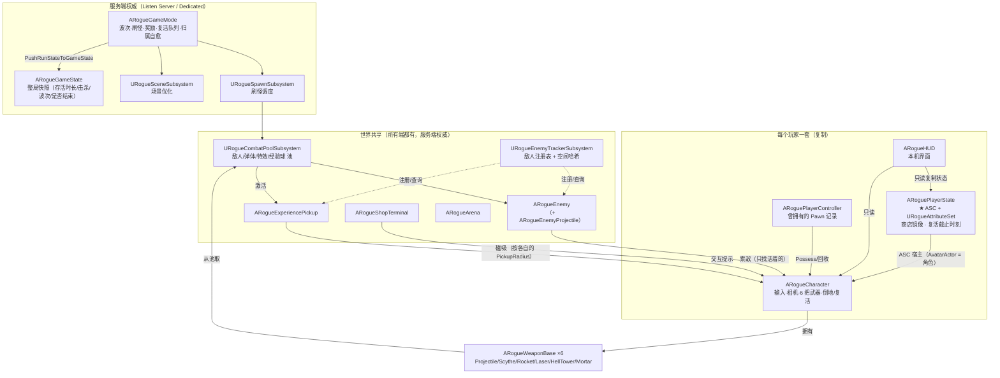
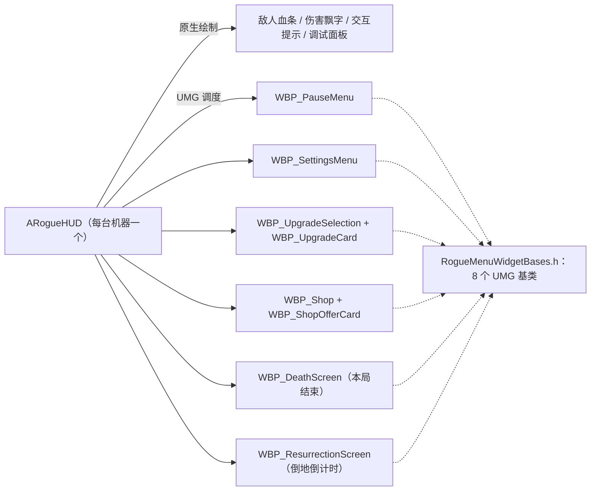
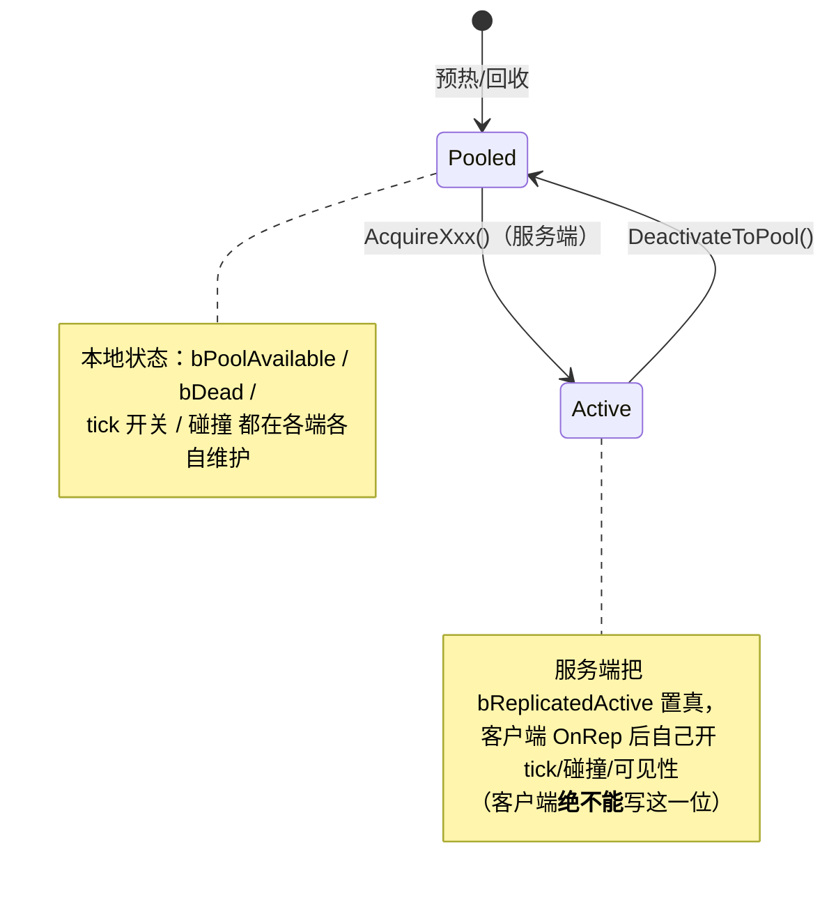
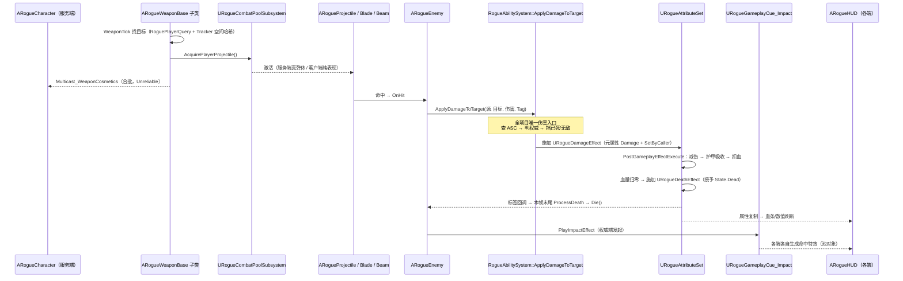
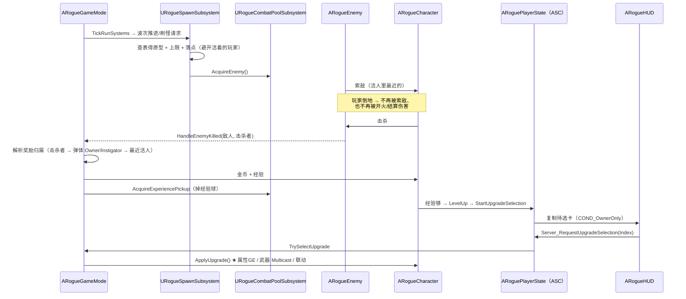

# ai 项目结构图（当前状态）

> 快照时间：GAS 迁移完成 + 代码瘦身之后。
> 本文只描述**现在**的结构；迁移过程与"为什么这么改"见 [Attribute-System-Migration.md](Attribute-System-Migration.md)
> 与 [System-Architecture-Overview.md](System-Architecture-Overview.md)。

---

## 0. 一页总览

| 层 | 目录 | 文件 | 行数 | 一句话职责 |
|---|---|---:|---:|---|
| 规则与全局 | `Core/` | 31 | 4410 | GameMode / GameState / 升级与商店规则 / 标签 / 通用查询 |
| 战斗 | `Combat/` | 26 | 4347 | 6 把武器 + 弹体 / 光束 / 刀片 / 特效（全部走对象池） |
| 敌人 | `Enemies/` | 10 | 4327 | 敌人本体、原型表、数据表、视觉资源、敌方弹体 |
| 玩家 | `Player/` | 10 | 3363 | 角色、PlayerState（**ASC 在这里**）、视觉组件、平衡资产 |
| 能力系统 | `AbilitySystem/` | 20 | 1599 | GAS 接入层：属性集、GE、能力、cue（只占全项目 8%） |
| 子系统 | `Subsystems/` | 8 | 891 | 对象池、敌人追踪、刷怪调度、场景优化 |
| UI | `UI/` | 4 | 2617 | HUD（原生绘制）+ 8 个 UMG 基类 |
| 世界 | `World/` | 6 | 971 | 竞技场、商店终端、经验球 |
| **合计** | `Source/ai/` | **117** | **~22.5k** | |

关键事实（回答"为什么结构是这样"）：

- **权威全在服务端**：AI、伤害、经验、刷怪、商店、复活时机都只在服务端算。
- **客户端只做三件事**：把复制的状态画出来（HUD/血条/飘字）、本地预测自己的操作（移动/开火/冲刺）、按复制的镜子推 UI。
- **数值只有一个真相源**：`URogueAttributeSet`（GAS）。角色上的 `MaxHealth/MoveSpeed/...` 是不可编辑的**只读缓存**。
- **对象池是硬约束**：200+ 敌人 + 上千弹体，所有战斗 actor 都必须能复用（池化契约见 §5）。

---

## 1. 源码目录树

```text
Source/ai/
├── ai.Build.cs                    模块依赖（GAS 插件等）
├── Public/                        头文件（与 Private 同构）
└── Private/
    ├── AbilitySystem/             ★ GAS 接入层（20 文件 / 1599 行）
    │   ├── RogueAbilitySystemComponent.*    ASC：Mixed 模式（玩家）/ Minimal（敌人）
    │   ├── RogueAttributeSet.*              唯一数值真相源 + 减伤链 + 死亡判定
    │   ├── RogueDamageEffect.*              伤害 GE（元属性 Damage + SetByCaller）
    │   ├── RogueAttributeUpgradeEffect.*    8 类属性升级共用的一份 GE
    │   ├── RogueUpgradeExecution.*          升级 GE 的 ExecutionCalculation（枚举→属性）
    │   ├── RogueStateEffects.*              ★ 三个"授予状态标签"的 GE 合并在此
    │   │                                    （基类 URogueStateTagEffect + 死亡/刚受伤/冲刺冷却）
    │   ├── RogueGameplayCue_Impact.*        C++ cue 通知 + 原生 cue 注册入口
    │   ├── RogueAbilitySystemLibrary.*      ApplyDamageToTarget（全项目唯一伤害入口）
    │   └── Abilities/
    │       ├── RogueGameplayAbility_Dash.*  冲刺技能（LocalPredicted）
    │       └── RogueAbilityTask_Dash.*      冲刺的位移任务
    ├── Combat/                    ★ 武器与弹体（26 文件 / 4347 行）
    │   ├── RogueWeaponBase.*                武器基类：配置行 + 目标选择 + 开火节流
    │   ├── RogueWeapon_Projectile/Scythe/Rocket/Laser/HellTower/Mortar.*
    │   ├── RogueProjectile.*                玩家弹体（池化）
    │   ├── RogueRocketProjectile.*          火箭（范围伤害）
    │   ├── RogueMortarProjectile.*          迫击炮（继承火箭，抛物线）
    │   ├── RogueLaserBeam.*                 激光束（池化）
    │   ├── RogueOrbitingBlade.*             环绕刀片（池化）
    │   └── RogueImpactEffect.*              命中特效（池化，由 cue 驱动）
    ├── Core/                      ★ 规则与全局（31 文件 / 4410 行）
    │   ├── RogueGameMode.*                  ★ 服务端总控（唯一权威；含复活队列/归属自愈/暂停看门狗）
    │   ├── RogueGameState.*                 复制给所有客户端的整局快照
    │   ├── RoguePlayerQuery.*               ★ "谁算活着"的唯一实现（4 处调用共用）
    │   ├── RogueGameplayTags.*              全部原生 Tag（C++ 声明，与 ini 无关）
    │   ├── RogueGameModeRules.*             波次/商店/刷怪的可调规则
    │   ├── RogueUpgradeSystem.*             抽卡：候选池 / 已购次数 / 排队
    │   ├── RogueUpgradeSystemRules.*        升级定义与出现规则（数据表驱动）
    │   ├── RogueShopSystem.*                每玩家一份的商店运行态（服务端）
    │   ├── RogueCombatPools.*               池容器与预热量配置（数据处理）
    │   ├── RogueEnemyTracker.*              敌人/经验球注册表 + 空间哈希（数据处理）
    │   ├── RogueCombatFeedback.*            伤害飘字：发给**本机所有本地玩家**
    │   ├── RogueGameModeConfig.h            可调参数结构体（RunState/Pool/Spawn/Boss/性能）
    │   ├── RogueTypes.h / RogueRewardTypes.h  枚举与统一奖励报价
    │   └── RogueGameBalanceAsset.* / RogueUpgradeDefinitionAsset.* / RogueUpgradeRuleAsset.*
    ├── Enemies/                   ★ 敌人（10 文件 / 4327 行）
    │   ├── RogueEnemy.*                     敌人本体（AI 只在服务端跑）
    │   ├── RogueEnemyArchetypes.*           原型结构 + 从硬编码构建（数据表缺省回退）
    │   ├── RogueEnemyDataTable.h            数据表行结构（8 种专属参数）
    │   ├── RogueEnemyDataTable.cpp          行 → 原型 的翻译
    │   ├── RogueEnemyVisualResources.*      8 种敌人的视觉资源表
    │   └── RogueEnemyProjectile.*           敌方弹体（池化）
    ├── Player/                    ★ 玩家（10 文件 / 3363 行）
    │   ├── RogueCharacter.*                 角色：输入、相机、武器、倒地/复活、属性镜像
    │   ├── RoguePlayerState.*               ★ ASC + 属性集 + 商店镜像 + 复活截止时刻
    │   ├── RoguePlayerController.*          记录"曾拥有的 Pawn"，供归属自愈回收
    │   ├── RogueCharacterVisualComponent.*  角色视觉（程序化搭建）
    │   └── RoguePlayerBalanceAsset.*        玩家基础属性（灌进属性集的唯一数据源）
    ├── Subsystems/                ★ 世界子系统（8 文件 / 891 行）
    │   ├── RogueCombatPoolSubsystem.*       UWorldSubsystem：所有战斗 actor 的池
    │   ├── RogueEnemyTrackerSubsystem.*     UTickableWorldSubsystem：注册表 + 剔除/降频
    │   ├── RogueSpawnSubsystem.*            UWorldSubsystem：波次刷怪、上限、落点
    │   └── RogueSceneSubsystem.*            UWorldSubsystem：场景性能优化开关
    ├── UI/                        ★ 界面（4 文件 / 2617 行）
    │   ├── RogueHUD.*                       原生绘制：血条/飘字/提示 + 所有界面调度
    │   └── RogueMenuWidgetBases.*           8 个 UMG 基类（见 §3）
    └── World/                     ★ 世界 actor（6 文件 / 971 行）
        ├── RogueArena.*                     竞技场边界与地面
        ├── RogueShopTerminal.*              商店终端（交互提示）
        └── RogueExperiencePickup.*          经验球（池化 + 磁吸）
```

★ = 这一层最常被改动的入口。

---

## 2. 运行时对象关系（谁拥有谁）



**要点**

- `ARogueCharacter` 与 `ARogueEnemy` 都实现了 `IAbilitySystemInterface`：
  玩家的 ASC **不在 Pawn 上**（在 `PlayerState`），Pawn 只做转发；敌人的 ASC 就在自己身上。
  漏掉这个转发接口的后果是"敌人打玩家永远不掉血"（详见头文件注释）。
- 子系统都是**世界级**的（`UWorldSubsystem`），随世界创建/销毁，不需要 GameMode 手动管理生命周期。

---

## 3. UI 组成



- 每个界面都是"**C++ 基类提供数据 + 蓝图实现外观**"：C++ 侧 `Update*View(ViewData)` 推数据，
  蓝图侧实现 `On*Updated` 画出来（例如 `URogueDeathScreenWidgetBase::UpdateDeathView`）。
- 输入模式由 **每台机器自己推导**（暂停菜单 / 商店 / 选卡 / 倒地 → GameAndUI + 光标），不需要 RPC。

---

## 4. 网络权威划分

| 内容 | 所在类 | 复制方式 |
|---|---|---|
| 波次 / 刷怪 / 击杀奖励 / 是否结束 | `ARogueGameMode`（服务端） | → `ARogueGameState` 快照 → 复制给所有人 |
| 属性（生命/护甲/移速/…） | `URogueAttributeSet`（服务端权威） | 每个属性 `COND_None`（常规复制） |
| 经验 / 等级 / 金币 | `ARogueCharacter` | `COND_OwnerOnly` |
| 商店报价 / 是否打开 / 刷新价格 | `ARoguePlayerState`（镜像字段） | `COND_OwnerOnly` |
| 复活截止时刻 | `ARoguePlayerState` | `COND_OwnerOnly`（各端自己换算剩余秒数） |
| 倒地状态 `bDead` | `ARogueCharacter` | 复制给**所有人**（队友要看得见） |
| 敌人是否活跃 `bReplicatedActive` | `ARogueEnemy` / 经验球 | 复制（池化对象必须显式告诉客户端"我上线了"） |
| 武器开火表现 | `ARogueCharacter::Multicast_WeaponCosmetics` | `NetMulticast, Unreliable`（每帧合批） |
| 武器升级 | `ARogueCharacter::Multicast_ApplyWeaponUpgrade` | `NetMulticast, Reliable`（顺序敏感） |
| 敌方弹体表现 | `ARogueEnemy::Multicast_SpawnCosmeticProjectile` | `NetMulticast, Unreliable` |
| 打击特效 | `RogueGameplayCues::EnsureNativeImpactCuesRegistered` + `URogueGameplayCue_Impact` | GAS cue 多播（原生类注册进 cue set） |
| 选卡 / 商店操作 / 重开 | `ARoguePlayerState::Server_Request*` | `Server, Reliable`（带 Validate） |

> ⚠️ 判"我是不是服务端"一律用 `GetNetMode() != NM_Client`，**不要用 `HasAuthority()`**：
> 客户端上"本机拥有"的 Pawn 也是 `ROLE_Authority`。参见 `ARogueCharacter::IsAuthoritySide()`。

---

## 5. 池化契约（所有战斗 actor 都必须遵守）



---

## 6. 数据流 A：一次开火 → 伤害 → 死亡



---

## 7. 数据流 B：刷怪 → 奖励 → 升级



---

## 8. 资产 ↔ 代码对应

| 资产 | 类型 | 对应代码 |
|---|---|---|
| `DT_FRogueEnemyArchetypeRow` | DataTable | `FRogueEnemyArchetypeRow` → `RogueEnemyDataTable.cpp` → `FRogueEnemyArchetype` |
| `DT_WeaponConfig` | DataTable | `FRogueWeaponTableRow`（`RogueWeaponBase.h`）→ 每把武器的配置 |
| `DT_FRogueUpgradeDefinitionRow` | DataTable | `FRogueUpgradeDefinitionRow` |
| `AS_RoguePlayerBalanceAsset` | DataAsset | `URoguePlayerBalanceAsset`（灌进属性集的基础属性） |
| `AS_RogueGameBalanceAsset` | DataAsset | `URogueGameBalanceAsset`（波次/商店/敌人平衡 ） |
| `AS_UpgradeDefinitionAsset` / `AS_RogueUpgradeRuleAsset` | DataAsset | `URogueUpgradeDefinitionAsset` / `URogueUpgradeRuleAsset` |
| `BP_RogueGameMode` | Blueprint | `ARogueGameMode`（**关卡默认 GameMode**） |
| `BP_RogueCharacter` | Blueprint | `ARogueCharacter`（蓝图里只配资源/数值引用） |
| `BP_RogueHUD` | Blueprint | `ARogueHUD`（挂 6 个 WBP 类） |
| `BP_EnemyBase` + 8 个敌人 BP | Blueprint | `ARogueEnemy`（原型参数全部来自数据表） |
| `BP_Projectile/*` | Blueprint | 玩家弹体/火箭/迫击炮/光束/刀片（只配外观） |
| `WBP_*`（8 个） | UMG | `RogueMenuWidgetBases.h` 的 8 个基类 |

---

## 9. "我要改 X，该动哪里"

| 想做的事 | 落点 |
|---|---|
| 加一张升级卡 | `RogueTypes.h`（枚举）→ `RogueUpgradeSystemRules.cpp`（定义/出现规则）→ `ARogueCharacter::ApplyUpgrade()`（落地） |
| 加一把新武器 | `RogueWeaponBase` 子类 → `DT_WeaponConfig` 加行 → `RogueCombatPools`（预热量）→ `ARogueHUD`（调试面板） |
| 加一种敌人 | `DT_FRogueEnemyArchetypeRow` 加行 + `BP_EnemyBase` 子类 → 必要时在 `RogueEnemyDataTable.cpp` 加专属参数翻译 |
| 改属性 / 减伤公式 | `URogueAttributeSet`（`PreAttributeChange` / `PostGameplayEffectExecute`）——**唯一数值真相源** |
| 加一个状态（如"眩晕"） | `RogueGameplayTags`（Tag）→ 派生 `URogueStateTagEffect`（**不要**再新建三个文件） |
| 改"谁算活着" | `RoguePlayerQuery`（全项目只有这一份定义） |
| 加一个界面 | `RogueMenuWidgetBases.h` 加基类 → `ARogueHUD` 里创建/推数据 → 建 WBP |
| 调波次/商店/刷怪参数 | `RogueGameModeRules.cpp` + `DT/AS_*` 资产 |
| 改伤害流程 | **只改** `RogueAbilitySystem::ApplyDamageToTarget` 与 `URogueAttributeSet::PostGameplayEffectExecute` |

---

## 10. 已知的待清理项（结构无关，但影响观感）

- `Content/StarterContent/`（612 MB）与 `Content/GameAssets/StarterContent/`（612 MB）**完全重复**；
  两份内部引用互相指向，不能直接删一边（详见对话记录里的分析）。
- `Content/BP/` 下的疑似废弃资产：`BP_AIController`、`BP_Enemy1`、`BP_EnemyHunter`（重定向器）、`NewBlueprint`。
- 数据表里 `MuzzleEffectLifetime` 配了值但代码从未读取（枪口特效回收时长用的是 cue 里的常数）。
- 代码侧已清理：旧的三个"授予标签" GE 文件、`URogueGameplayCueManager`、`FRogueUpgradeEffectApplier`
  均已删除/合并（见 §1 的结构即当前真实状态）。
