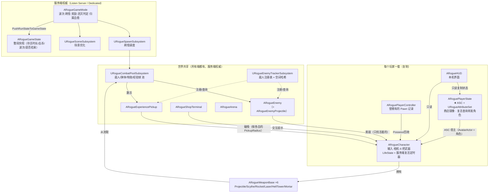
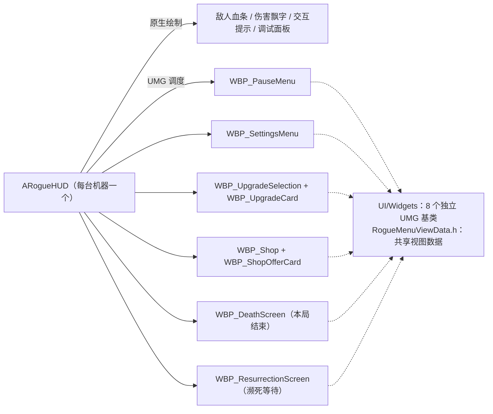
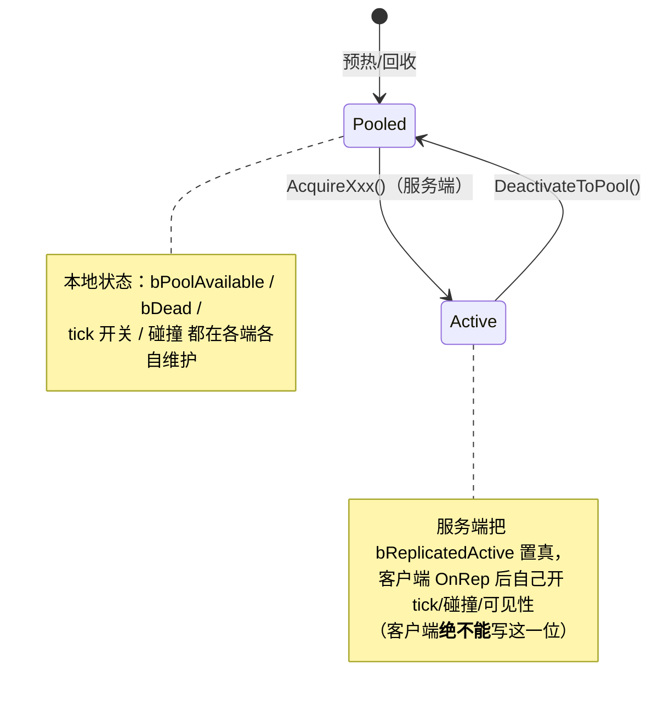
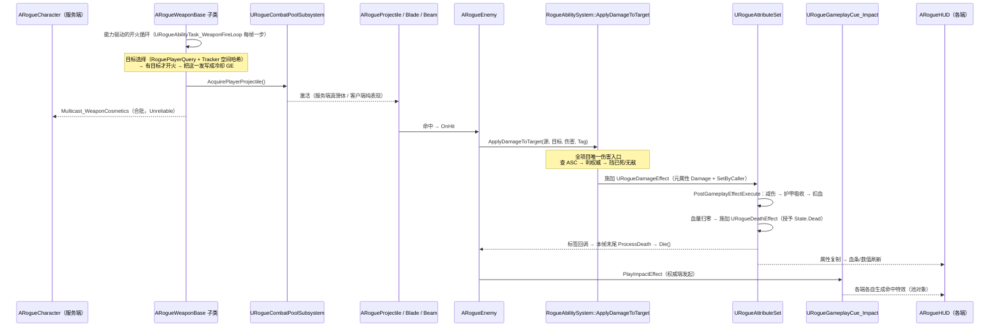
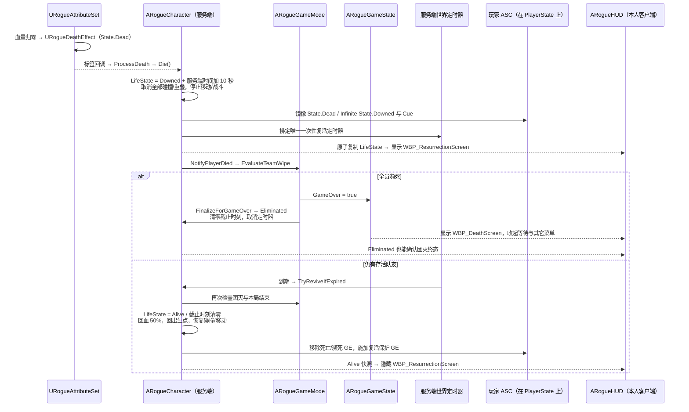
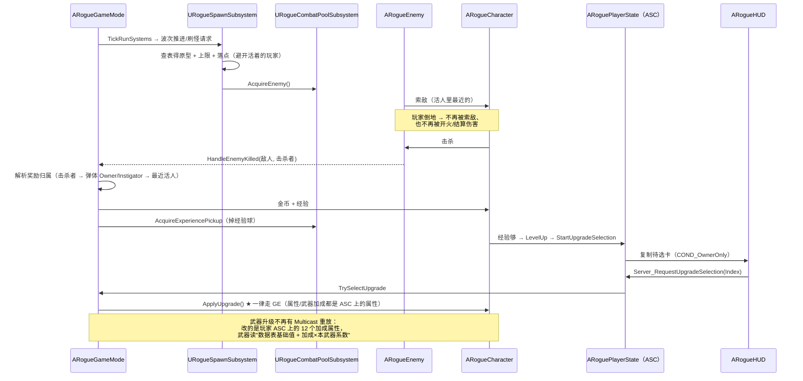

# ai 项目结构图（当前状态）

> 本文反映按玩法职责整理后的目录。类文件索引与新增文件约定见 [Class-Organization.md](Class-Organization.md)。
> 本次整理保留类名、反射类型、蓝图接口和原有方法体；大类只拆分函数实现文件，运行时对象关系保持。
> GAS 的历史迁移过程和验证记录见 [GAS-Main-Architecture-Plan.md](GAS-Main-Architecture-Plan.md)、
> [Attribute-System-Migration.md](Attribute-System-Migration.md)。历史文档中的旧路径以当前组织说明为准。
> 玩家濒死/复活已改为 `LifeState` 原子复制与单服务端定时器；当前规则见 [Player-LifeCycle.md](Player-LifeCycle.md)，历史 Phase 4 的 GE 到期复活方案已被取代。

---

## 0. 一页总览

| 目录 | 一句话职责 |
|---|---|
| `Framework/` | GameMode / GameState、整局调度、规则与平衡配置 |
| `AbilitySystem/` | GAS 数值与行为：ASC、AttributeSet、AbilitySet、标签、能力、任务、GE、Cue |
| `Combat/` | 武器与弹体、战斗表现、对象池、敌人注册及空间查询 |
| `Progression/` | 升级定义与抽卡规则、商店运行态、统一奖励报价 |
| `Player/` | 玩家角色、PlayerState（ASC 宿主）、控制器、玩家查询与视觉组件 |
| `Enemies/` | 统一敌人运行时、原型与数据表、刷怪调度 |
| `World/` | 竞技场、经验球、商店终端、场景优化 |
| `UI/` | HUD + Widgets 下各自独立的 UMG 基类与共享视图数据 |
| `Shared/` | 跨玩法域共用的枚举、复制载荷与基础结构体 |
| `Debug/` | 自检开关、升级链路诊断、攻击与压测探针 |

关键事实：

- **权威全在服务端**：AI、伤害、经验、刷怪、商店、复活时机都只在服务端算。
- **客户端表现与预测**：画复制状态，本地预测自己的操作，按复制状态推导界面。
- **数值只有一个真相源**：`URogueAttributeSet`。角色上的 `MaxHealth/MoveSpeed/...` 是只读镜像。
- **升级使用 Infinite GE 叠层**：20 种升级各自对应一个 GE 子类，按目标叠层；单次数值来自 `Data.Magnitude`。最大生命 / 护甲上限的补量由属性变化委托实现。
- **能力授予支持 AbilitySet**：玩家默认技能与敌人攻击支持数据驱动，缺少配置保留回退路径。武器能力由各武器的 `GetFireAbilityClass()` 提供，在角色侧幂等授予。
- **玩家生命周期只有一份真值**：`ARogueCharacter::LifeState` 同时复制 `Alive / Downed / Eliminated` 与服务器复活截止时刻；濒死固定 10 秒，仅由服务端定时器触发复活，团灭取消全部复活。
- **对象池是高频对象的复用契约**：敌人、弹体、表现对象与经验球获取后激活，结束后回池（见 §5）。

| 玩法动作 | 能力 | 持续/一次性 | 联机策略 | 谁决定时机 |
|---|---|---|---|---|
| 冲刺 | `URogueGameplayAbility_Dash` | 一次性 | LocalPredicted | 输入经 `AbilityLocalInputPressed` 激活 |
| 武器自动开火 | `URogueWeaponAbility` 系列 | 持续心跳 | LocalPredicted | 能力与冷却 GE；镰刀持续轨道保留表现 Tick |
| 敌人接触 / 远程攻击 | `URogueEnemyAttackAbility` 子类 | 一次性 | ServerOnly | AI 决策，能力执行 |
| 敌人地面波 | `URogueEnemyAttackAbility_GroundWave` | 持续到波结束 | ServerOnly | AI 决策，能力任务推进 |

---

## 1. 源码目录树

`Public/` 放声明，`Private/` 放对应实现。以下业务目录在两边对应；共享类型、聚合头及私有 helper 按需要只存在于一侧。

```text
Source/ai/
├── ai.Build.cs / ai.h / ai.cpp
├── Public/
└── Private/
    ├── Framework/
    │   ├── RogueGameMode.* / RogueGameState.*
    │   ├── RogueGameModeRules.* / RogueGameModeConfig.h
    │   ├── RogueGameBalanceAsset.*
    │   └── RogueGameMode.Progression.cpp / RogueGameMode.Players.cpp
    ├── AbilitySystem/
    │   ├── RogueAbilitySystemComponent.* / RogueAbilitySystemLibrary.*
    │   ├── RogueAttributeSet.* / RogueAttributeMacros.h
    │   ├── RogueAbilitySet.* / RogueGameplayTags.*
    │   ├── Abilities/    RogueGameplayAbility_Dash / RogueWeaponAbility / RogueEnemyAttackAbility
    │   ├── Tasks/        RogueAbilityTask_Dash / WeaponFireLoop / AttackTick
    │   ├── GameplayEffects/ RogueDamageEffect / RogueAttributeUpgradeEffect / RogueStateEffects
    │   └── Cues/         RogueGameplayCue_Impact / RogueGameplayCue_Downed
    ├── Combat/
    │   ├── Weapons/      RogueWeaponBase + Projectile / Scythe / Rocket / Laser / HellTower / Mortar
    │   ├── Projectiles/  RogueProjectile / RogueRocketProjectile / RogueMortarProjectile / RogueEnemyProjectile / RogueOrbitingBlade
    │   ├── Visuals/      RogueLaserBeam / RogueImpactEffect / RogueCombatFeedback
    │   ├── Pooling/      RogueCombatPools / RogueCombatPoolSubsystem
    │   └── Targeting/    RogueEnemyTracker / RogueEnemyTrackerSubsystem
    ├── Progression/
    │   ├── RogueRewardTypes.h
    │   ├── Upgrades/     RogueUpgradeSystem / RogueUpgradeSystemRules / 升级定义和规则资产
    │   └── Shop/         RogueShopSystem
    ├── Player/
    │   ├── RogueCharacter.* / RoguePlayerState.* / RoguePlayerController.*
    │   ├── RoguePlayerLifeState.h
    │   ├── RoguePlayerQuery.* / RogueCharacterVisualComponent.* / RoguePlayerBalanceAsset.*
    │   └── RogueCharacter.{GAS,Input,Weapons,Progression,Lifecycle}.cpp
    ├── Enemies/
    │   ├── RogueEnemy.*
    │   ├── Data/         RogueEnemyArchetypes / RogueEnemyDataTable / RogueEnemyVisualResources
    │   └── Spawning/     RogueSpawnSubsystem
    ├── World/            RogueArena / RogueShopTerminal / RogueExperiencePickup / RogueSceneSubsystem
    ├── UI/
    │   ├── RogueHUD.*
    │   └── Widgets/      8 个 WidgetBase、RogueMenuViewData.h、RogueMenuWidgetBases.h 聚合头
    ├── Shared/           RogueTypes.h
    └── Debug/            RogueSelfTest.* / RogueCharacter.SelfTest.cpp / RogueGameMode.SelfTest.cpp
```

`.GAS.cpp`、`.Players.cpp` 等仍实现原来的 `ARogueCharacter` / `ARogueGameMode`，没有新增运行时类或组件。UI 的八个基类与九个视图结构体按声明职责分文件；`RogueMenuWidgetBases.h` 保留为聚合 include，蓝图继承关系和事件签名保留。完整名称见 [类文件组织说明](Class-Organization.md)。

---

## 2. 运行时对象关系（谁拥有谁）



**要点**

- `ARogueCharacter` 与 `ARogueEnemy` 都实现了 `IAbilitySystemInterface`：
  玩家的 ASC **不在 Pawn 上**（在 `PlayerState`），Pawn 只做转发；敌人的 ASC 就在自己身上。
  漏掉这个转发接口的后果是"敌人打玩家永远不掉血"（详见头文件注释）。
- 子系统都是**世界级**的（`UWorldSubsystem`），随世界创建/销毁，不需要 GameMode 手动管理生命周期。

---

## 3. UI 组成



- 每个界面都是"**C++ 基类提供数据 + 蓝图实现外观**"：C++ 侧 `Update*View(ViewData)` 推数据，
  蓝图侧实现 `On*Updated` 画出来（例如 `URogueDeathScreenWidgetBase::UpdateDeathView`）。
- 输入模式由 **每个本地 HUD 自己推导**（暂停菜单 / 商店 / 选卡 / 濒死 → GameAndUI + 光标；团灭 → UIOnly + 光标），不需要 RPC。
- 两个死亡相关 WBP 在原生 HUD 中具有默认类引用；濒死时显示复活界面，团灭时只显示结算。团灭判据为 `GameState.GameOver || 本机角色.IsEliminated()`，兼容跨 actor 复制顺序。无 Pawn 时仍可按 GameState 显示结算。
- 濒死或团灭期间强制收起商店、升级、暂停和设置。复活/结算 Widget 在蓝图更新事件之后应用最终可见性，隐藏时停止动画；缓存属于各 HUD，并核对实际可见性。

---

## 4. 网络权威划分

| 内容 | 所在类 | 复制方式 |
|---|---|---|
| 波次 / 刷怪 / 击杀奖励 / 是否结束 | `ARogueGameMode`（服务端） | → `ARogueGameState` 快照 → 复制给所有人 |
| 属性（生命/护甲/移速/…） | `URogueAttributeSet`（服务端权威） | 每个属性 `COND_None`（常规复制） |
| 经验 / 等级 / 金币 | `ARogueCharacter` | `COND_OwnerOnly` |
| 商店报价 / 是否打开 / 刷新价格 | `ARoguePlayerState`（镜像字段） | `COND_OwnerOnly` |
| 玩家生命阶段 / 复活截止时刻 | `ARogueCharacter::LifeState`（`FRoguePlayerLifeState`） | `Phase + ReviveServerTime` 作为同一状态属性原子复制给所有人；`OnRep_LifeState` 应用幽灵/正常表现 |
| 复活倒计时 | `ARogueCharacter::GetReviveSecondsRemaining()` | 复制的服务器截止时刻减同步服务器时间，限制为 0–10 秒；PlayerState 查询转发角色，客户端不触发复活 |
| 复活无敌 | ASC 上的 `URogueInvulnerableEffect`（带时长的 GE） | GE 明细按玩家 ASC 的 Mixed 模式同步给本人，标签/Cue 由 GAS 复制；伤害判定只在服务端 |
| 濒死标签 / 全息环 | ASC 上的 Infinite `URogueDownedEffect` | GAS 复制标签/Cue；由生命周期显式授予/移除，不作为复活计时器 |
| 敌人是否活跃 `bReplicatedActive` | `ARogueEnemy` / 经验球 | 复制（池化对象必须显式告诉客户端"我上线了"） |
| 武器开火表现 | `ARogueCharacter::Multicast_WeaponCosmetics` | `NetMulticast, Unreliable`（每帧合批） |
| 武器升级结果 | 玩家 ASC 上的 12 个加成属性 + `ARogueCharacter::WeaponBonusSnapshot` | 属性常规复制 + 快照 `COND_None`（**不再有** Multicast 重放） |
| 敌方弹体表现 | `ARogueEnemy::Multicast_SpawnCosmeticProjectile` | `NetMulticast, Unreliable` |
| 打击特效 | `RogueGameplayCues::EnsureNativeImpactCuesRegistered` + `URogueGameplayCue_Impact` | GAS cue 多播（原生类注册进 cue set） |
| 选卡 / 商店操作 / 重开 | `ARoguePlayerState::Server_Request*` | `Server, Reliable`（带 Validate） |

> ⚠️ 判"我是不是服务端"一律用 `GetNetMode() != NM_Client`，**不要用 `HasAuthority()`**：
> 客户端上"本机拥有"的 Pawn 也是 `ROLE_Authority`。参见 `ARogueCharacter::IsAuthoritySide()`。

---

## 5. 池化契约（所有战斗 actor 都必须遵守）



---

## 6. 数据流 A：一次开火 → 伤害 → 死亡



### 6.1 数据流 A2：玩家濒死 → 复活 / 团灭



客户端倒计时到零仍显示等待界面，直到收到服务器 `Alive`；客户端 GE 的标签到达或效果到期不会触发生命阶段转换。团灭后的 `Eliminated` 是本局终态，只有重开新局才恢复。详细流程与验证用例见 [Player-LifeCycle.md](Player-LifeCycle.md)。

---

## 7. 数据流 B：刷怪 → 奖励 → 升级



---

## 8. 资产 ↔ 代码对应

| 资产 | 类型 | 对应代码 |
|---|---|---|
| `DT_FRogueEnemyArchetypeRow` | DataTable | `FRogueEnemyArchetypeRow` → `RogueEnemyDataTable.cpp` → `FRogueEnemyArchetype` |
| `DT_WeaponConfig` | DataTable | `FRogueWeaponTableRow`（`RogueWeaponBase.h`）→ 每把武器的配置 |
| `DT_FRogueUpgradeDefinitionRow` | DataTable | `FRogueUpgradeDefinitionRow` |
| `AS_RoguePlayerBalanceAsset` | DataAsset | `URoguePlayerBalanceAsset`（灌进属性集的基础属性） |
| `AS_RogueGameBalanceAsset` | DataAsset | `URogueGameBalanceAsset`（波次/商店/敌人平衡 ） |
| `AS_UpgradeDefinitionAsset` / `AS_RogueUpgradeRuleAsset` | DataAsset | `URogueUpgradeDefinitionAsset` / `URogueUpgradeRuleAsset` |
| `BP_RogueGameMode` | Blueprint | `ARogueGameMode`（**关卡默认 GameMode**） |
| `BP_RogueCharacter` | Blueprint | `ARogueCharacter`（蓝图里只配资源/数值引用） |
| `BP_RogueHUD` | Blueprint | `ARogueHUD`（挂 6 个 WBP 类） |
| `BP_EnemyBase` + 8 个敌人 BP | Blueprint | `ARogueEnemy`（原型参数全部来自数据表） |
| `BP_Projectile/*` | Blueprint | 玩家弹体/火箭/迫击炮/光束/刀片（只配外观） |
| `WBP_*`（8 个） | UMG | `UI/Widgets/` 下的 8 个基类（聚合头仍可统一包含） |

---

## 9. "我要改 X，该动哪里"

| 想做的事 | 落点 |
|---|---|
| 加一张升级卡 | `Shared/RogueTypes.h`（枚举）→ `Progression/Upgrades/`（定义/出现规则）→ `AbilitySystem/GameplayEffects/RogueAttributeUpgradeEffect`（GE 子类与映射）→ `RogueCharacter.Progression.cpp`（落地） |
| 加一把新武器 | `RogueWeaponBase` 子类（构造里设 `FireAbilityClass` + 实现 `CollectFireTargets`/`FireAtTargets`）→ `RogueWeaponAbility` 加一个子类（一行 `GetDrivenWeaponClass`）→ `DT_WeaponConfig` 加行 → `RogueCombatPools`（预热量） |
| 改武器开火节奏 | 武器侧的 `GetEffectiveCooldown()`（**加成怎么换算成冷却**是武器的知识）；节拍由 `URogueWeaponCooldownEffect` 承担，不要再去加 float 计时器 |
| 加一种敌人（攻击方式） | `DT_FRogueEnemyArchetypeRow` 加行 + `BP_EnemyBase` 子类 → 攻击走 `URogueEnemyAttackAbility`（AI 只决策、能力执行） |
| 改属性 / 减伤公式 | `URogueAttributeSet`（`PreAttributeChange` / `PostGameplayEffectExecute`）——**唯一数值真相源** |
| 加一个状态（如"眩晕"） | `RogueGameplayTags`（Tag）→ 在 `RogueStateEffects.h` 里派生 `URogueStateTagEffect`（**不要**新建三个文件）→ 带时长的话时长走 SetByCaller `Data.Duration` |
| 加一个持续型玩法（逐帧推进） | 拿 `URogueAbilityTask_WeaponFireLoop` / `URogueAbilityTask_AttackTick` 当模板：`bTickingTask = true` + 能力里一个 `TickXxxStep` |
| 改"谁算活着" | `ARogueCharacter::IsAlive()` 与 `RoguePlayerQuery`；索敌、奖励和团灭共用这条判断 |
| 加一个界面 | `UI/Widgets/` 加独立基类文件，共享数据放 `RogueMenuViewData.h` → `ARogueHUD` 创建/推数据 → 建 WBP |
| 调波次/商店/刷怪参数 | `RogueGameModeRules.cpp` + `DT/AS_*` 资产 |
| 改伤害流程 | **只改** `RogueAbilitySystem::ApplyDamageToTarget` 与 `URogueAttributeSet::PostGameplayEffectExecute` |
| 改濒死 / 复活 / 团灭规则 | `Player/RoguePlayerLifeState.h`、`RogueCharacter.Lifecycle.cpp` 与 `RogueGameMode.Players.cpp`；等待固定为 `DownedDurationSeconds = 10`，保持唯一服务端定时器与团灭终态 |
| 改复活保护时长 | `ARogueCharacter::ReviveInvulnerableSeconds`，写入 `URogueInvulnerableEffect` 的 `Data.Duration`，默认 1.5 秒 |

---

## 10. 联机分工（改造后由 GAS 天然给出）

| 机器 | 有哪些能力的实例 | 结果 |
|---|---|---|
| 服务端 | 每个玩家 PlayerState 的 ASC + 每只敌人的 ASC | 权威模拟：所有人的武器、所有敌人的攻击（伤害只在这里结算） |
| 本人客户端 | 只有自己的（技能列表按 `COND_OwnerOnly` 复制） | 本地预测开火/冲刺，零延迟 |
| 其它客户端 | 没有别人的技能 | 只画服务端广播的那一发（`Multicast_WeaponCosmetics`） |

判定原则：**"谁模拟"由"谁有这个能力的实例"决定**，不再手写 `HasAuthority() || IsLocallyControlled()`。
两个例外是有意的：镰刀的环绕轨道（纯表现，任何机器都要画）与敌人攻击（`ServerOnly`，客户端一个实例都没有）。

---

## 11. 开发自检（默认关）

`Rogue.SelfTest.WeaponUpgradeChain 1` 打开后，一次无头运行会依次验证并打印：

1. **升级链路**：5 项属性升级 + 6 类数量升级 → 每把武器的生效数值（数据表基础值 + 加成）
2. **跨端一致性**：每 10 秒打印一次每个玩家的"属性集加成 / 角色快照 / 各武器生效值"，
   服务端与客户端按**玩家名**逐行对齐（还有敌人数量、帧时、倒地与复活剩余）
3. **敌人攻击**（Phase 3）：三种攻击的"AI 决策尝试次数"与"能力执行次数"
4. **濒死/复活**：`LifeState` 的阶段、服务器复活截止时刻与剩余秒数，复活后的 `State.Invulnerable`；独立回归用例见 [Player-LifeCycle.md](Player-LifeCycle.md)

外加四个探针（前三个在自检全部完成之后才跑，避免干扰数值对比；压测可单进程运行，但仍需开启 WeaponUpgradeChain 入口）：
`ProbeContactAttack`（把敌人改硬并瞬移到玩家身上）、`ProbeGroundWaveAttack`（直接刷一只震荡柱）、
`ProbeDeathAndRevive`（对玩家施加致命伤害）、`ProbeEnemyStress`（一次刷 N 只压测敌人）。
**为什么必须用探针**：无头自检里武器太强，敌人贴不上来、玩家也不会倒地 ——
"没实现"与"没机会触发"在计数上完全一样（这两条路径各踩过一次）。

性能压测（量"200+ 敌人不退化"这条红线，必须同时开启升级链路自检）：

```
Rogue.SelfTest.WeaponUpgradeChain 1            # 压测入口，必须开启
Rogue.SelfTest.EnemyStress 200                 # 刷 200 只"很硬、伤害 0"的敌人围在玩家周围
Rogue.SelfTest.DisableEnemyAttackAbilities 1   # 对照：不授予敌人攻击能力
```

已有测量记录中，199 只敌人同时在场时：能力开启 **2.95 ms/帧**、关闭 2.92 ms/帧 —— GAS 化的敌人攻击
在 200 敌人规模下约 **0.03 ms/帧（≈1%）**，对应 ~205 次攻击/秒。
（详细数据与"空转隐患"的修复见 [GAS-Main-Architecture-Plan.md](GAS-Main-Architecture-Plan.md) 的 Phase 3。）

---

## 12. 已知的待清理项（结构无关，但影响观感）

- 旧扫描曾把外层 `StarterContent/` 与 `GameAssets/StarterContent/` 记为完全重复；这一结论已过期，不能作为删除依据。本次美术目录整理保留两份资产：原有游戏引用版本仍在 `GameAssets/StarterContent/`，原外层包的美术资产收进 `GameAssets/Library/StarterContent/`，示例地图及构建数据仍留在原 `StarterContent/Maps/`。其它同名包也按此原则保留，结构与范围见 [Content-Organization.md](Content-Organization.md)。
- `Content/BP/` 下的疑似废弃资产：`BP_AIController`、`BP_Enemy1`、`BP_EnemyHunter`（重定向器）、`NewBlueprint`。
- 数据表里 `MuzzleEffectLifetime` 配了值但代码从未读取（枪口特效回收时长用的是 cue 里的常数）。
- `ARogueEnemy::PerformContactDamage` / `FireProjectileAtPlayer` 是**行为树/蓝图的兼容入口**，
  语义是"立刻结算、不走能力"（基类默认行为走能力）。当前没有蓝图重写 `OnBehaviorTick`，所以这条入口没被用到；
  保留是为了不让"重写了行为 Tick 的敌人蓝图"失效。
- `Tools/audit_dead_code.py` 报出的 16 个"无源码引用"符号里，除了上面提到的那两个入口，
  其余都是有意保留的 `BlueprintPure/BlueprintCallable` 取值器（给蓝图用，蓝图引用不在源码里）。
- `BP_EnemyHunter` 之类的敌人在 BP 上**没有** `EnemyArchetypeDataTable` 时，原型会回退到硬编码
  （`RogueEnemyArchetypes::BuildEnemyArchetype`）；数据表仍是首选来源，改动只在 `DT_*`。
- 代码侧已清理：旧的三个"授予标签" GE 文件、`URogueGameplayCueManager`、`FRogueUpgradeEffectApplier`、
  旧 PlayerState 的独立 `ReviveServerTime`（现合并到角色 `LifeState`）、`TickReviveInvulnerability`、`GetServerTimeSeconds`、
  未使用的 `Effect.Upgrade.Weapon` 标签 —— 均已删除（见 §1 的结构即当前真实状态）。
